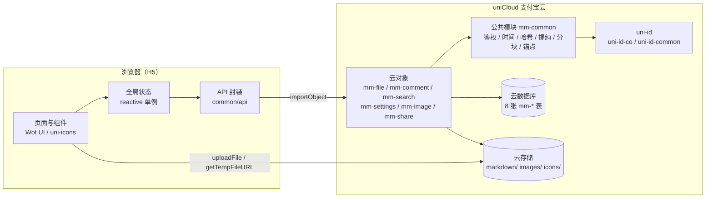

# MarkdownManager

基于 **uni-app + uniCloud（支付宝云）** 的个人文档管理器：把 Markdown 文档与图片存进自己的云空间，在 PC 和手机浏览器上阅读、编辑、批注、搜索、分享。

在免费额度内，单用户可以不花一分钱长期使用：云函数、数据库、云存储、前端网页托管都跑在支付宝云免费空间里，不需要服务器、域名备案和对象存储。

> 交付端：仅 H5（PC + 移动端浏览器），不含小程序与原生 App。
>
> 数据模型：个人空间模型，文档按账号隔离，默认不跨用户可见。

---

## 目录

- [1. 它解决什么问题](#1-它解决什么问题)
- [2. 功能一览](#2-功能一览)
- [3. 技术栈](#3-技术栈)
- [4. 系统架构](#4-系统架构)
- [5. 数据模型](#5-数据模型)
- [6. 云对象接口](#6-云对象接口)
- [7. 目录结构](#7-目录结构)
- [8. 快速开始](#8-快速开始)
- [9. 零成本使用说明](#9-零成本使用说明)
- [10. 使用指南](#10-使用指南)
- [11. 测试](#11-测试)
- [12. 项目文档](#12-项目文档)
- [13. 已知限制](#13-已知限制)
- [14. 安全设计](#14-安全设计)
- [15. 许可证](#15-许可证)

---

## 1. 它解决什么问题

网盘能存文件，但不适合读 Markdown；笔记软件功能齐全，但订阅费和容量限制长期存在；自建服务又要买服务器、配域名、做备份。

这个项目把三件事放在一起：

- **文档有序**：用可无限嵌套的文件夹与自定义图标组织 Markdown，而不是把文件堆在一个目录里。
- **读写一体**：同一页面里阅读、编辑、插图、批注，保存带版本校验，不怕另一台设备同时修改。
- **成本可控**：整套服务运行在 uniCloud 支付宝云免费空间内，个人使用不产生费用。

适合个人知识库、笔记归档、写作草稿，以及希望把照片和文档放在自己账号下的用户。

---

## 2. 功能一览

| 模块 | 能力 |
| --- | --- |
| 文档库 | 上传 `.md`（一次最多 9 个）、新建、重命名、移动、导出；同目录重名自动追加 `-copyN` |
| 目录树 | 文件夹无限嵌套，可创建、改名、移动、删除；8 个预制图标 + 自定义图标上传 |
| 阅读 | GFM 渲染（标题、列表、表格、代码块、引用、图片），自动跟随系统深浅色 |
| 编辑 | 在线编辑 Markdown，实时预览开合，插入图片；受控内容，冲突后不丢稿 |
| 图片空间（照片 / 插图） | 统一存放图片：上传新图、复用已有图、引用计数、被引用时二次确认后清理 |
| 批注 | 选中正文任意段落添加批注；文档改动后按四级优先级重新定位，定位失败标记为 `orphaned` 而不误绑 |
| 搜索 | 文件名、标签、批注、正文四个维度；正文走分块索引，命中可回到原段落 |
| 回收站 | 普通删除进回收站可还原；彻底删除同时清理云存储文件、批注与索引，文件夹递归处理 |
| 分享 | 生成只读分享链接，有效期 1 小时 / 1 天 / 7 天；打开分享不授予任何写权限 |
| 账号 | 账号功能可开关；开启时走 uni-id 登录注册，关闭后所有访客共用匿名身份 |
| 权限 | 权限功能可开关；开启时首个注册用户成为管理员，可为其他账号分配可读 / 可写 |
| 外观 | 自动 / 浅色 / 深色三态主题；极大到大五档字号；本地记忆偏好 |
| 交互 | PC 三栏（目录 / 列表 / 内容），移动端单栏 + 抽屉；首屏加载动画；剪贴板检测（分享链接与文本追加） |
| 并发 | 乐观锁 `version` 校验；冲突弹窗支持「覆写 / 放弃」，放弃后编辑内容原样保留 |

---

## 3. 技术栈

| 层 | 选型 | 说明 |
| --- | --- | --- |
| 前端框架 | uni-app（Vue 3）+ Vite | 单代码库输出 H5，按需使用浏览器 API |
| UI 组件 | Wot Design Uni `1.14.x` + uni-icons | 通过 `pages.json` 的 `easycom.custom` 引入，不做全局注册 |
| Markdown 编辑器 | `md-editor-v3` `4.21.3` | 受控 `v-model` + 图片上传钩子；**锁定 4.x**，5.x 起依赖 Vue 3.5 的 `useId`，与 HBuilderX 内置 Vue 运行时不兼容 |
| Markdown 渲染 | `marked` `18.x` + `dompurify` `3.x` | GFM 渲染，输出前统一消毒，防 XSS |
| 云端 | uniCloud 支付宝云 | 云对象 + 云数据库（兼容 MongoDB 语法）+ 云存储 + 前端网页托管 |
| 认证 | `uni-id-pages` / `uni-id-co` / `uni-id-common` | 官方账号体系，支持账号密码、验证码、邮箱等方式 |
| 样式 | SCSS + CSS 变量 | `--mm-*` 变量统一控制主题与字号 |
| 测试 | Node 内置 `node:test` | 272 条用例，覆盖算法、鉴权、云对象与前端静态断言 |

---

## 4. 系统架构



三条硬规则贯穿全部实现：

1. **前端不直连数据库**。8 张 `mm-*` 表的 `permission` 四项全为 `false`，所有读写只能经过云对象，绕过前端也拿不到数据。
2. **上传与删除分权**。客户端只负责 `uploadFile` 与 `getTempFileURL`；彻底删除必须由云对象在服务端执行 `deleteFile`，避免留下孤儿文件。
3. **元数据由服务端裁决**。`created_at`、`updated_at`、`size`、`content_hash`、`version` 一律服务端计算，客户端传入值被忽略。

---

## 5. 数据模型

| 表名 | 用途 | 关键点 |
| --- | --- | --- |
| `mm-files` | 文档与文件夹 | `type` 区分 `file` / `folder`，`parent_id` 自关联成树，`icon` 存图标，`version` 做乐观锁 |
| `mm-comments` | 段落批注 | 存 `selected_text`、`prefix` / `suffix`、`start_offset` / `end_offset`、`status` |
| `mm-images` | 图片空间 | 只存云存储 `fileID`，临时 URL 不落库；`ref_count` 记录被引用次数 |
| `mm-image-refs` | 图片与文档引用关系 | `image_file_id` + `doc_id`，用于清理前的引用检查 |
| `mm-index-chunks` | 正文分块索引 | 标题分块 + 超长切片，`revision` 与文档 `version` 对齐，搜索前过滤陈旧索引 |
| `mm-settings` | 系统配置 | 单文档 `key = app_config`，存账号开关、权限开关、管理员 ID |
| `mm-user-permissions` | 用户权限 | 账号级 `role` / `can_read` / `can_write` |
| `mm-shares` | 只读分享 | `token`（base64url）、`doc_id`、`expire_at`、`revoked`、`access_count` |

时间字段统一为 `timestamp`，创建 / 更新时间带 `forceDefaultValue: {"$env": "now"}`，作为绕过云对象写库时的服务器时间兜底。

---

## 6. 云对象接口

| 云对象 | 方法数 | 职责 |
| --- | --- | --- |
| `mm-file` | 17 | 目录树、列表、上传登记、内容读写、重命名、移动、图标、标签、回收站、导入导出、索引重建 |
| `mm-comment` | 5 | 批注增删改查与重定位 |
| `mm-search` | 1 | 文件名 / 标签 / 批注 / 正文四维搜索 |
| `mm-settings` | 6 | 配置读取与更新、用户列表、权限分配、管理员初始化 |
| `mm-image` | 5 | 图片登记、列表、临时 URL、引用同步、清理 |
| `mm-share` | 3 | 创建分享、校验令牌、只读打开 |

统一返回 `{ errCode, errMsg, data }`，前端归一化为 `{ code, data, message }`。完整入参、出参与错误码见 [docs/API.md](docs/API.md)。

---

## 7. 目录结构

```text
MarkdownManager/
├─ pages/
│  ├─ index/index.vue          # 主壳：目录树 + 文件列表 + 阅读/编辑 + 批注 + 分享
│  ├─ settings/settings.vue    # 设置：账号权限、回收站、图片空间、主题字号
│  └─ ...                      # hello uniCloud 示例页，未注册、不参与编译
├─ components/                 # 12 个业务组件（目录树、列表、阅读器、编辑器、批注、搜索、回收站等）
├─ common/
│  ├─ api/                     # 云对象调用封装，统一错误分类与登录失效处理
│  ├─ store/                   # 全局 reactive 单例，editorContent 为唯一编辑内容源
│  └─ utils/                   # 提纯、选区映射、上传、主题、字号、下载、UUID 等纯函数
├─ uniCloud-alipay/
│  ├─ cloudfunctions/          # 6 个业务云对象 + 公共模块 mm-common（其余为示例）
│  └─ database/                # mm-* 表 Schema、索引、初始化数据
├─ static/icons/               # 8 个预制文件夹图标 + 明暗主题图标
├─ tests/                      # 单元测试与 UI 静态断言（272 条）
├─ docs/                       # PRD、架构、API、部署、验收、测试报告
├─ App.vue                     # 启动：读取配置、注入主题与字号、标记首屏就绪
├─ pages.json                  # 仅注册 2 个业务页 + 16 个 uni-id 页面
└─ manifest.json               # 服务空间 spaceId、H5 路由与基路径
```

---

## 8. 快速开始

### 8.1 环境要求

| 项 | 要求 |
| --- | --- |
| HBuilderX | 3.97 及以上（支付宝云最低版本要求），建议使用最新稳定版 |
| Node.js | 20 及以上（本地测试使用 Node 22 验证） |
| uniCloud 空间 | 1 个支付宝云服务空间；需 DCloud 账号完成实名，且实名主体已注册并实名支付宝 |
| 依赖 | `sass >= 1.78`（Wot UI 组件内 SCSS 编译需要） |

### 8.2 安装依赖

```bash
npm install
```

依赖清单：`wot-design-uni`、`md-editor-v3@4.21.3`、`marked`、`dompurify`、`sass`（devDependency）。

### 8.3 创建并关联服务空间

1. 用 HBuilderX 打开项目根目录。
2. 右键 `uniCloud-alipay` 目录 → **关联云服务空间**，选择已有空间或新建支付宝云空间。
3. 确认 `manifest.json` 的 `uniCloud` 节点：

```json
"uniCloud": {
  "provider": "alipay",
  "spaceId": "你的服务空间 ID",
  "clientSecret": ""
}
```

`spaceId` 决定 H5 端请求发往哪个空间，必须填写；密钥类配置不要提交到仓库。

### 8.4 上传数据库 Schema

在 `uniCloud-alipay/database` 目录中，逐个右键上传：

| 类型 | 文件 |
| --- | --- |
| 表结构 | `mm-files`、`mm-comments`、`mm-images`、`mm-image-refs`、`mm-index-chunks`、`mm-settings`、`mm-user-permissions`、`mm-shares` 的 `.schema.json` |
| 索引 | `mm-files`、`mm-comments`、`mm-images`、`mm-index-chunks`、`mm-settings`、`mm-user-permissions` 的 `.index.json` |
| 初始化数据 | `mm-settings.init_data.json`（预置 `app_config` 单文档） |

若初始化数据未生效，可跳过：`getConfig()` 在配置缺失时会返回默认值（账号开启、权限关闭）；也可以在云对象调试面板执行一次 `mm-settings.ensureConfig()` 把配置写入数据库。

### 8.5 上传公共模块与云对象

1. 右键 `cloudfunctions/common/mm-common` → **上传公共模块**。
   上传时若弹出「选择公共模块」，必须勾选 `uni-id-common` 与 `uni-config-center`，否则云对象里的 `require('uni-id-common')` 会失败，表现为所有操作都提示「请先登录」。
2. 依次上传 6 个云对象：`mm-settings` → `mm-file` → `mm-comment` → `mm-search` → `mm-image` → `mm-share`。

### 8.6 部署 uni-id 并配置密钥

1. `uni-id-co` 不在 `uniCloud-alipay/cloudfunctions` 下，而在：
   `uni_modules/uni-id-pages/uniCloud/cloudfunctions/uni-id-co`，右键 **上传部署**。
2. 打开 `uni_modules/uni-config-center/uniCloud/cloudfunctions/common/uni-config-center/uni-id/config.json`：
   - `passwordSecret`：密码加密盐，改成随机串；
   - `tokenSecret`：令牌签名密钥，**务必替换默认值**；
   - 按需开启账号密码、短信、邮箱等登录方式。
3. 上传 `uni-config-center` 后重新部署 `uni-id-co`，保证两边读取同一份配置。

### 8.7 构建与部署 H5

1. HBuilderX 菜单 **发行 → 网站-PC Web 或手机 H5**，产物在 `unpackage/dist/build/web`。
2. `manifest.json` 当前配置：

```json
"h5": {
  "router": {
    "mode": "hash",
    "base": "/mymarkdown/web/"
  }
}
```

   部署到其他路径时，同步修改 `base`，并更新 `common/constants.js` 中的 `SHARE_WEB_BASE`（分享链接拼接使用）。
   静态托管不支持 URL rewrite，**必须保持 hash 模式**，入口形如 `/mymarkdown/web/index.html#/`。
3. 在 uniCloud 控制台 → 跨域配置中，把页面域名加入白名单，否则登录与云对象请求会被浏览器拦截。
4. 若要把整个前端也放在支付宝云：在控制台开启 **前端网页托管**，把 `build/web` 上传到对应目录即可。

### 8.8 首次启动

1. 打开站点，首页读取 `mm-settings.getConfig()`；配置文档缺失时返回默认值，可在调试面板执行 `ensureConfig()` 落库。
2. 默认账号功能开启，未登录会跳转登录页，注册第一个账号。
3. 在设置页开启「权限功能」，首个注册用户自动成为管理员，可给其他账号分配可读 / 可写。
4. 单人使用可关闭「账号功能」，之后所有访客共用匿名身份 `__anonymous__` 与同一份文档库；系统内用户数大于 1 时，服务端会拒绝关闭。

---

## 9. 零成本使用说明

支付宝云为每个账号提供 1 个包年包月免费空间。以下额度来自 uniCloud 官方定价页（2026-11 核对，最终以控制台为准）：

| 资源 | 免费额度 |
| --- | --- |
| 云函数资源使用量 | 1000 GBs / 月 |
| 云函数调用次数 | 1.5 万次 / 月 |
| 云函数出网流量 | 1 GB / 月 |
| 云数据库容量 | 6.2 GB天（约 200 MB 常驻一个月） |
| 数据库读 / 写 | 62 万 RU / 31 万 WU 每月 |
| 云存储容量 | 155 GB天（约 5 GB 常驻一个月） |
| 云存储上传 / 下载次数 | 1000 次 / 2000 次每月 |
| CDN 流量 | 1 GB / 月，回源 0.5 GB / 月 |
| 前端网页托管 | 155 GB天 + 1 GB CDN / 月 |
| 有效期 | 默认 1 个月，到期前 15 天可续期 |

四个必须知道的前提：

1. **免费空间需要每月续期**。到期未续期会停服，资源保留 7 天后释放。「零成本」= 用量不超额 + 按时手动续期，不是一次开通永久免费。
2. **任一指标超额会导致整个空间停服**。建议在控制台把资源上限设为套餐的 100%，避免意外转入按量计费。
3. **最紧张的是 CDN 流量**。按单张图片 300–500 KB 估算，1 GB 大约够浏览 2000–3000 次。个人自用、少量分享足够；不适合做公开相册或高频外链。
4. **图片压缩很关键**。上传前压到长边 1600 px 左右，既省容量也省流量；同一张图在多个文档中复用时，走「从图片空间选择」而不是重复上传。免费额度不够时，基础版为 4.5 元 / 月。

---

## 10. 使用指南

### 文档

- **上传**：中栏「上传」支持多选 `.md`，文件直传云存储后写入文件表；同名自动加 `-copyN`。
- **新建**：生成一篇 `# 未命名文档` 并直接进入编辑态。
- **整理**：文件夹与文档都通过行菜单「移动到…」选择目标目录；文件夹可无限嵌套，禁止移入自身子树。
- **导出**：行菜单「导出 md」，图片会替换为临时 URL 后下载；临时 URL 过期不影响库内原文。

### 图片与照片

- 编辑态点「插入图片」，可以**上传新图片**，也可以**从图片空间选择**已有图片（不重复上传）。
- 图片以 `` 存储，只有打开文档时才换取临时 URL 展示，数据库里不保存临时地址。
- 「设置 → 图片空间」可浏览、查看大小与上传者、单独清理。被文档引用的图片会先提示引用它的文档，确认后才强制删除。

### 批注

- 阅读态选中文字，浮动「添加批注」出现，写入原文、上下文与偏移量。
- 文档保存后，所有 `active` 批注按「原位 → 全文唯一匹配 → 上下文消歧 → 无法定位」四级重定位；最后一级标记 `orphaned`，不会错绑到其他文字。
- 点击正文高亮或右侧批注条目可定位；批注详情显示原文、内容、时间与批注人。

### 搜索

- 顶部搜索框支持文件名、标签、批注、正文四个范围，可切换「全部」。
- 正文检索走分块索引，结果带 `start_offset`，点击可跳到对应段落；索引 `revision` 与文档版本不一致时会被过滤。
- 标签目前只有展示与检索，没有编辑入口（`mm-file.setTags` 接口已就绪，可直接调用写入）。

### 分享

- 文件行菜单「分享…」，选择 1 小时 / 1 天 / 7 天，生成只读链接并复制到剪贴板。
- 打开分享只能阅读，不显示编辑入口；账号功能开启且未登录时，会先引导登录再打开。
- 服务端会校验令牌的 `expire_at` 与 `revoked`；撤销入口尚未做进界面，需要在数据库把对应记录置为 `revoked: true`。

### 账号与权限

- 默认账号开启：多用户各自登录，文档按账号隔离。
- 权限开启：管理员可在设置页把某个账号设为只读，服务端会拒绝其写请求。
- 账号关闭：进入匿名共享模式，适合单人自用；多人账号未清理时无法关闭。
- 权限是**账号级**的，只决定该账号能不能写自己的文档，不会让别人的文档变得可见。

### 外观

- 顶栏主题按钮在自动 / 浅色 / 深色间循环；设置页可精确选择。
- 字号五档，正文与阅读器按 `em` 联动，改完立即生效。
- 手机端默认单栏，左上角按钮唤起目录抽屉；有未保存修改时底部出现保存按钮。

---

## 11. 测试

```bash
# 全部用例
npm test

# 仅阅读态选区映射
npm run test:ui
```

当前结果：**272 条通过 / 0 失败**。覆盖范围：

| 类别 | 内容 |
| --- | --- |
| 核心算法 | Markdown 提纯、分块、批注四级定位、重名生成、UUID、哈希 |
| 云对象 | 文件增删改查与版本冲突、批注锚点校验、四维搜索、图片引用、分享令牌 |
| 鉴权 | token 校验、账号 / 权限开关、写权限拦截、错误码一致性 |
| 前端 | 选区映射、图片双态、上传参数、移动目标、事件绑定、P0 链路静态断言 |

测试全部是不依赖云环境的纯函数与源码级断言，可在本地直接跑；真实云存储、登录与多会话冲突仍需部署后按 [docs/DEPLOY.md](docs/DEPLOY.md) 第 11 节验收。

---

## 12. 项目文档

| 文档 | 内容 |
| --- | --- |
| [docs/PRD.md](docs/PRD.md) | 产品需求、角色、业务规则、验收标准 |
| [docs/ARCHITECTURE.md](docs/ARCHITECTURE.md) | 架构设计、坐标系、数据表、权限模型、关键决策记录 |
| [docs/API.md](docs/API.md) | 云对象方法、入参出参、统一错误码 |
| [docs/DEPLOY.md](docs/DEPLOY.md) | 服务空间、Schema、云函数、uni-id、H5 部署与排查 |
| [docs/AC-CHECKLIST.md](docs/AC-CHECKLIST.md) | AC-01 ~ AC-31 自检对照 |
| [docs/TEST-REPORT-R1.md](docs/TEST-REPORT-R1.md) ~ [R4](docs/TEST-REPORT-R4.md) | 各轮测试报告 |

文档记录的是设计与验收过程，其中测试条数与「H5 未编译」等状态属于当时结论；当前实现以代码与本文为准。

---

## 13. 已知限制

| # | 限制 | 说明 |
| --- | --- | --- |
| 1 | 仅支持 Markdown 文档 | 上传入口限定 `.md`，表结构保留 `extension` 字段为后续格式预留 |
| 2 | 照片没有独立相册入口 | 图片经「文档插图」进入图片空间，可在设置页浏览与清理，暂不支持脱离文档批量上传 |
| 3 | 标签没有编辑入口 | 列表与搜索支持标签，但界面未提供打标签操作，需调用 `mm-file.setTags` 写入 |
| 4 | 图片插入追加到文末 | `md-editor-v3` 4.21.3 未暴露稳定的光标 API，无法按光标位置插入 |
| 5 | 分享是只读快照 | 不支持多人协作编辑；账号开启时打开分享仍需登录；撤销需在数据库置 `revoked` |
| 6 | 权限为账号级 | 不支持「某篇文档只给某人看」的文档级授权，需要时须新增授权表 |
| 7 | 临时 URL 有时效 | 正文只存 `fileID`，每次打开重新换取；把临时 URL 复制到外部系统会过期失效 |
| 8 | 图片不随文档彻底删除 | 图片可能被多篇文档复用，需在图片空间单独清理 |
| 9 | 免费空间需按月续期 | 见第 9 节；超额会整体停服 |
| 10 | 极端情况下可能产生孤立文件 | 上传成功但落库失败时，云存储会残留文件，需在控制台手动清理 |
| 11 | 索引与批注重定位失败不阻断保存 | 保存仍成功，返回 `indexed: 0`，可调用 `mm-file.rebuildIndex` 补偿 |

---

## 14. 安全设计

- **数据库不直连**：8 张表 `permission` 全为 `false`，前端无法用 clientDB / JQL 绕过业务层。
- **服务端二次校验**：每个云对象在 `_before` 解析 token 并注入身份，写操作再经 `assertWrite` / `assertAdmin` 校验，前端隐藏按钮不作为安全边界。
- **用户隔离**：文档按 `user_id` 查询，非本人文档统一返回 `1003`。
- **XSS 防护**：`marked` 渲染结果先经 `DOMPurify` 消毒，再插入页面。
- **密钥不入库**：`.secrets/`、`.env*` 已在 `.gitignore` 中排除；`manifest.json` 只保留 `spaceId`，不要提交 `accessKey` / `secretKey` / `tokenSecret`。
- **分享最小权限**：分享接口只返回正文快照，不携带任何写授权；令牌为随机 base64url，服务端限制有效期 5 分钟至 30 天。

---

## 15. 许可证

[Apache License 2.0](LICENSE)
