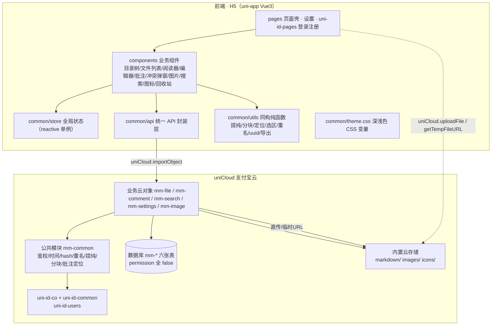
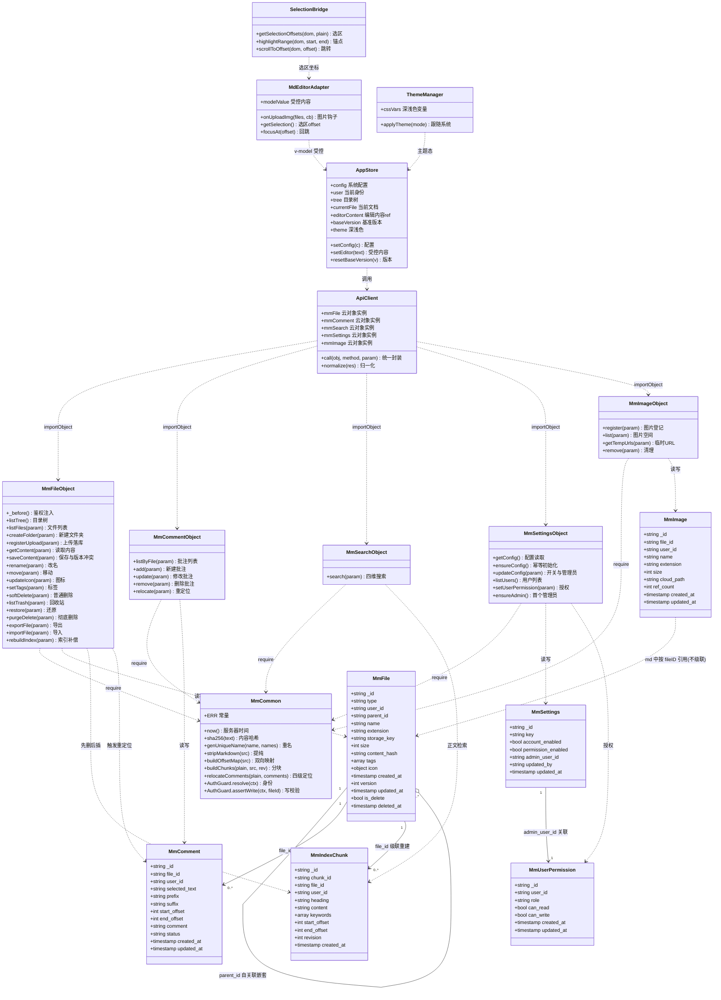
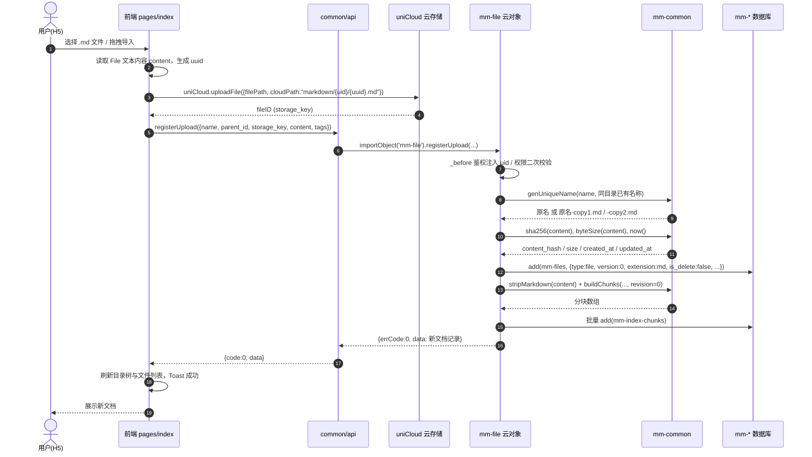
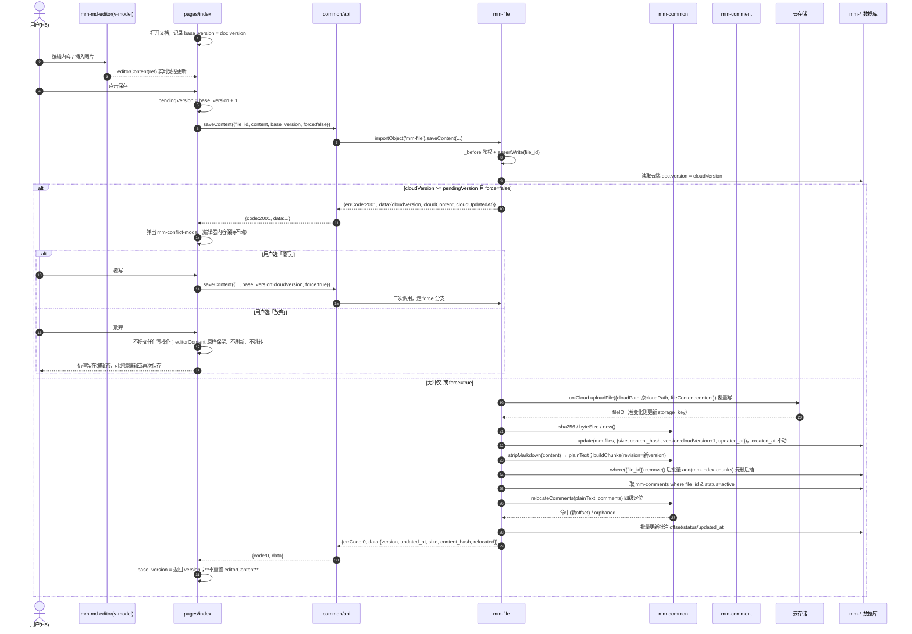
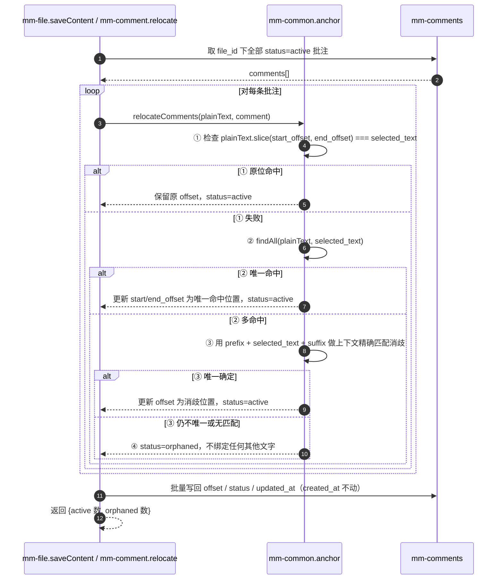
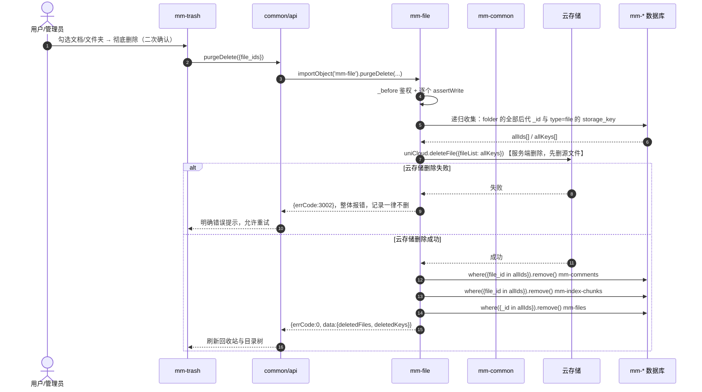
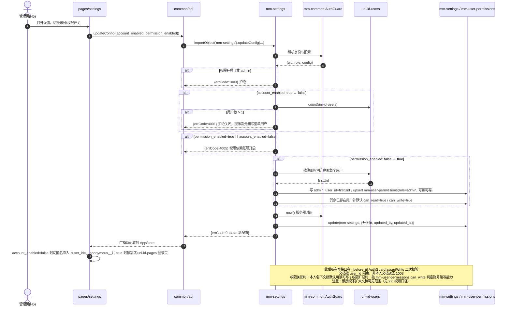
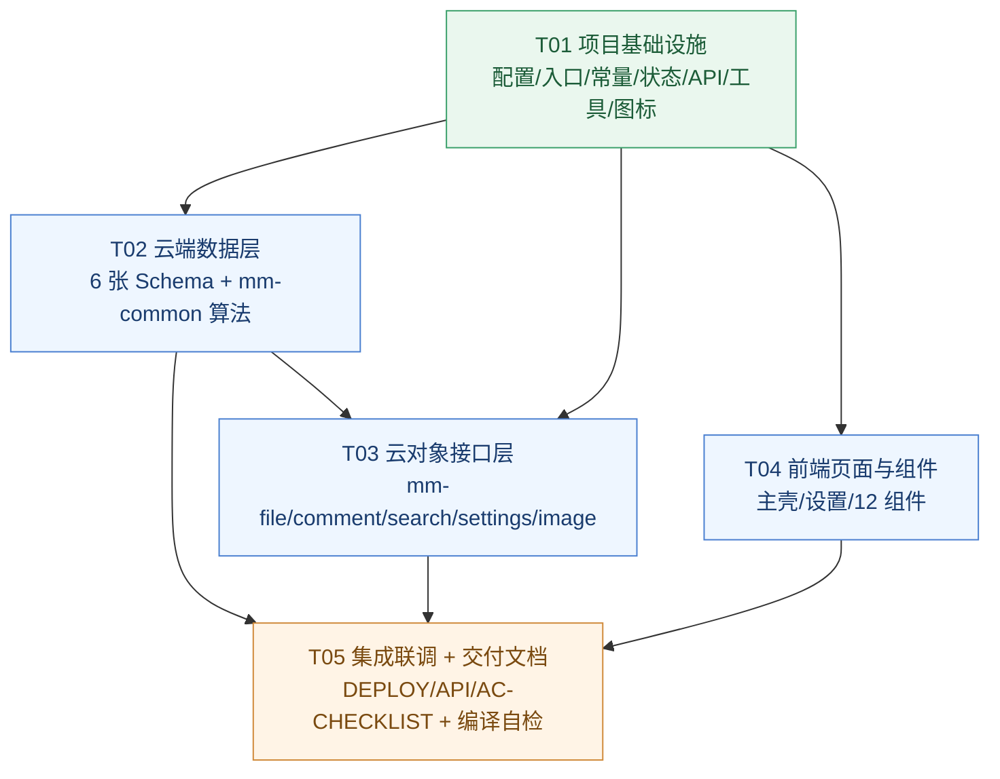

# MarkdownManager 系统架构设计与任务分解

> 角色：架构师（高见远）
> 文档状态：定稿，作为工程师实现与 QA 验收的唯一设计基线
> 上游基线：`docs/PRD.md`（唯一需求来源）、`C:\Users\markJing\Desktop\MarkdownManager设计要求.md`（数据表字段定义以原文为准）、`AGENTS.md`（项目行为规则）
> 全文中文；所有代码注释、UI 文案、命名说明均使用中文。

---

## 0. 设计基线与现实约束核验

### 0.1 上游基线

本设计不另起炉灶，严格遵守 PRD 已定稿的：交付端（仅 H5）、技术栈（uni-app Vue3 + uniCloud 支付宝云 + Wot UI + uni-id-pages/uni-id-co/uni-id-common）、交付边界（可编译源码 + DB Schema + 云对象 + 依赖 + 中文部署文档，云端部署由用户在 HBuilderX 完成）、C1~C7 业务规则、R01~R31 需求池、Q1~Q7 默认假设、AC-01~AC-31 验收标准。

### 0.2 项目现状核验（已实际读盘确认）

| 核验项 | 实际情况 | 对设计的约束 |
| --- | --- | --- |
| `package.json` | 仅模板元数据，无 `scripts`、无 `dependencies` | 需新增 `dependencies`；根目录可直接 `npm install` |
| `manifest.json` | `vueVersion: "3"`；`h5.router.mode=history`、`base=/h5/` | Vue3 组合式 API；页面跳转 URL 需带 `/h5/` 前缀认知；不用 hash 路由 |
| `main.js` | `createSSRApp(App)` 返回 `{ app }`，含 `#ifdef VUE3` 条件编译 | **保持原结构，仅加中文注释**；Wot UI 不在此注册（实测 `app.use` 不可用），改由 `pages.json` 的 `easycom.custom` 引入，见 7.3 |
| `pages.json` | 29 个示例页 + 5 项示例 `tabBar`；已注册 uni-id-pages 登录/注册页 | 重写为业务页；**uni-id-pages 的登录/注册/资料页注册项必须保留**（AC-17）；`tabBar` 整体移除（单页壳 + 抽屉）；**新增顶层 `easycom.custom` 规则 `^wd-(.*)`** |
| `App.vue` | `onLaunch` 里调用 `checkUpdate()`，含微信条件编译 | 保留原逻辑，追加首屏配置读取与主题初始化；不删除既有代码 |
| `uni_modules/` | 已内置 uni-id-pages、uni-id-common、uni-id、uni-config-center、uni-file-picker、uni-popup、uni-icons、uni-easyinput、uni-forms、uni-list、uni-fab、uni-load-more、uni-transition 等 | 走 `easycom.autoscan` 自动引入，**无需显式 import**；Wot UI 这类 npm 源码包另走 `easycom.custom` |
| `uni_modules/uni-id-pages/uniCloud/cloudfunctions/uni-id-co/` | `uni-id-co` 云对象源码在此（非主 `cloudfunctions/` 目录） | 由用户在 HBuilderX 中"上传部署 uni_modules 内云函数"；业务云对象不直接调用其内部方法，仅通过 `uni-id-common.checkToken` 校验身份 |
| `uni_modules/wot-design-uni/` | **不存在** | **npm 安装 `wot-design-uni@1.14.0` + `pages.json` 配 `easycom.custom`**（官方唯一接法，uni-app 不支持全局挂载组件）；需 `sass >=1.78` 编译组件内 scss，见 7.3 |
| `uniCloud-alipay/database/` | 大量示例 `.schema.json` / `.index.json` / `.init_data.json`；schema 格式为 `{bsonType, required, permission, properties}`，索引格式为 `[{IndexName, MgoKeySchema:{MgoIndexKeys:[{Name,Direction}], MgoIsUnique}}]` | 新增的 `mm-*.schema.json` / `.index.json` 必须沿用此格式 |
| `uniCloud-alipay/cloudfunctions/` | 示例云函数 add/get/remove/update/common/user-center 等；云对象 `index.obj.js` 支持 `_before` 拦截器、`this.getMethodName()`、`this.getClientInfo()`，返回风格为 `{errCode, errMsg, data}` | 新增独立命名业务云对象；**不改动、不删除任何示例云函数** |
| `uniCloud-alipay/cloudfunctions/common/hello-common/` | 公共模块 `package.json` 含 `name` + `main`，被 `require('hello-common')` 引用 | 业务公共模块命名为 `mm-common`，各云对象 `require('mm-common')` 复用算法 |
| `static/` | 已有 logo/tabbar/userImg 等示例资源 | 新增 `static/icons/` 预制文件夹图标；**不删除既有资源** |
| `index.html` | 存在（H5 模板入口） | 不改动 |

### 0.3 交付边界

本地交付：①可编译 H5 源码 ②全部 DB Schema ③云对象/云函数源码 ④依赖清单与安装说明 ⑤中文部署与联调文档。
不在本地交付：服务空间创建/绑定、Schema 与云函数上传部署、真实 uni-id 登录、真实云存储读写联调、多端兼容验证。这些由用户在 HBuilderX 完成，AC 中标注「部署后验证」的条目本地只做源码级与静态逻辑验证。

### 0.4 全局硬约束（工程师必须遵守）

1. **删除守卫**：AGENTS.md 严禁永久删除文件。示例页、示例云函数、示例 schema、示例静态资源**一律不物理删除**。
2. **「无示例残留」的实现口径（主理人拍板，AC-29 按此验收）**：重写 `pages.json`，使 `pages` / `tabBar` 只指向本次新增的业务页面及必要保留的 uni-id-pages 页面，示例文件保留在磁盘但不参与编译；云侧新增独立命名的业务云对象（`mm-*`），不改动也不删除现有示例云函数。
3. **仅 H5**：可使用 `window` / `document` / `crypto.subtle` / DOM Range 等浏览器 API，但涉及平台差异的工具函数须加 `#ifdef H5` 或运行时守卫，不得引入小程序/App 专属 API。
4. **服务端为准**：`created_at` / `updated_at` / `size` / `content_hash` / `version` 一律由云对象计算与写入，客户端传值一律忽略（AC-04）。
5. **组件引入边界（按 T01 实测修订）**：①`uni_modules/` 内置组件走 easycom `autoscan`，模板直接用标签；②`wot-design-uni` 虽为 npm 包但**是 uni_modules 源码形态**，走 `pages.json` 的 `easycom.custom` 规则 `^wd-(.*)` 映射，模板直接用 `<wd-*>` 标签，**禁止** `app.use` / `app.component` / 具名 `import` 组件 / 引入 `.css`；③`md-editor-v3`、`marked`、`dompurify` 等 npm JS 模块必须在页面/组件内显式 `import`。原「easycom 不覆盖 npm 包」的论断仅对默认 `autoscan` 成立，`easycom.custom` 可映射到 `node_modules` 路径。
6. **所有数据库读写经云对象**：`mm-*` 表 `permission` 四项全为 `false`，禁止 clientDB/JQL 直连，杜绝绕过前端的越权写入（AC-20）。

### 0.5 设计基线修订记录

| 修订 | 内容 | 来源 |
| --- | --- | --- |
| R1 · Wot UI 接入方式全量修订 | 实测 `wot-design-uni@1.14.0` 为 uni_modules 源码形态：`main` 指向 `index.ts`（仅导出 useToast/useMessage/dayjs/locale/composables），**无 default plugin、无具名组件导出、全包无 .css**（样式在各组件 SFC 的 `index.scss`）。原 7.3 的 `import WotUI` + `app.use(WotUI)` + `dist/wot-design-uni.css` 三条均无法解析；原 7.4 的按需 `import { WdButton, ... }` 同样不成立，且组件模板内 `<wd-icon>` 等标签依赖 easycom 解析，只注册少数组件会让内部标签悬空。**改为单一形态**：`pages.json` 配 `easycom.custom`，`main.js` 不做任何 Wot 注册，组件由 `<wd-*>` 标签直接用；新增 `sass >=1.78`（推荐 `^1.98`）编译组件内 scss。同步修订 0.4 / 1.3 / 4.1 / 4.3 / 6.2 / 7.1~7.4 / 9.5。 | 工程师 T01 实测反馈 |
| R1 · 依赖实际版本对齐 | `md-editor-v3` 实际 7.1.0（原设计 `^4.x`）、`marked` 实际 18.2.0（原设计 `^12.x`），均为 Vue3 兼容稳定版，版本约束按实测值更新；T04 需核对 `MdEditor` 具名导出、CSS 路径、`onUploadImg` 签名与 `marked` API（见 7.4）。 | 工程师 T01 实测反馈 |
| R2 · 依赖 API 只读实测，**Q4 裁决维持** | `md-editor-v3@7.1.0`：`MdEditor` / `MdPreview` / `MdCatalog` 等具名导出在、`onUploadImg(files, callBack)` **仍在且签名未变**、`modelValue` + `update:modelValue` 受控在、`lib/style.css` 与 `lib/preview.css` 真实存在；`marked@18.2.0`：`import { marked }` 可用、`marked.parse()` 与 `marked.use({gfm:true,breaks:true})` 实测通过（表格/换行正确输出）。**Q4 四项硬约束之②满足，不触发 1.4 降级条件，Vditor 不启用，裁决维持不变。** 新增三条落地约束：①`onUploadImg` 是 **prop 不是 emit**，模板须用 `:onUploadImg="fn"`，禁用 `@onUploadImg`（编译成 `onOnUploadImg` 不命中）；②`dompurify@3.4.17` 在无 `window` 的 Node 下 default 为未绑定工厂函数（无 `.sanitize`），**必须在 H5 客户端渲染阶段调用**，禁止模块顶层/SSR 求值；③Wot UI 包内**无 `wd-dialog`**，确认弹层用 `wd-message-box` / `wd-popup`。另 `useToast` / `useMessage` 需页面放 `<wd-toast />` / `<wd-message-box />` 挂载点；`easycom.custom` 的 `^wd-(.*)` 规则对包内 99/99 个组件目录 100% 匹配。 | 工程师只读实测反馈 |
| R2 · 真实 H5 编译验证缺口 | T01 仅完成配置与静态覆盖率校验，**尚未跑真实 H5 编译**（本地为 HBuilderX 工程无 CLI 编译通道，且 T04 页面未建）。已新增为 **T05 必检项**（4 步，见 6.2 T05）；AC-29 的最终判据以该编译结果为准，本地阶段不据此判失败。 | 工程师如实反馈 |
| R3 · **阅读态 DOM ↔ plainText 同源假设修正（架构缺陷修复）** | 工程师实测证实：初版 1.5 假设「预览 DOM 文本节点序列与 `plainText` 逐字对齐」**不成立**（含标题/强调/链接/图片/列表/代码块/表格的样例：plainText 57 字符 vs DOM 去标签文本 55 字符，`plain === domText` 为 false）。三类偏差：①图片 `` → `` 无文本节点，而 stripMarkdown 保留 alt 文字；②表格内容行 DOM 只有单元格文字，plainText 保留 `|` 竖线；③块级标签间 HTML 格式化换行/重复空行与 plainText 段落间单 `\n` 数量位置不同。**后果**：`getSelectionOffsets` 若直接累加 `Range.toString().length`，产出的是 DOM 序列坐标而非 plainText 坐标，写入 `mm-comments` 后云侧 `relocateComments` ① `plain.slice(start,end)===selected_text` 错位，含图片/表格/多段落文档首次保存即可能大批误判 orphaned，冲击 C4 / AC-13/14/15/23。**裁决：采用「一次性对齐标注」方案，否决「微调 stripMarkdown 迁就 marked 输出」**（后者令坐标系依赖渲染器版本、降低提纯文本质量、需重跑两份同构一致性与 T02 全部自检，且 marked 格式化空白仍随版本变化）。机制：`mm-md-viewer` 挂载后构造 `domPlainMap`（顺序贪心双指针 + 节点内字符级映射），三个对外签名不变、内部改读映射；`selected_text/prefix/suffix` 一律由 `plainText.slice()` 生成、禁用 `Range.toString()`；间隙字符不高亮不改 status。**仅改 T04 阅读器与 `common/utils/selection.js`，不动两份 mm-text.js / 云侧 anchor·chunk / schema / 云对象**；R3 为纯前端桥接，不属 8.3 同构双份范畴。详见 1.5「R3 对齐标注」。 | 工程师只读实测 + 架构师裁决 |
| R4 · **权限口径澄清（文档口径矛盾修复，不改实现）** | QA 后端源码级测试 132/132 通过，但发现文档 2.6 写的「权限关闭：所有用户默认全部可读可写」与实现（`canAccess()` 在 `permission_enabled=false` 时对非本人文档返回 `1003`；`listFiles` / `mm-search` 只返回本人文档）及 PRD 角色表存在口径歧义。**裁定采用个人空间模型**：①文档按 `user_id` 隔离，非本人文档默认不可见、不可读写（`1003`）；②「权限关闭时默认可读可写」的准确含义是每个登录用户对**本人名下**全部文档默认拥有可读 + 可写能力，**不产生跨用户可见性**；③跨用户共享唯一路径 = 账号开启 + 权限开启 + 管理员授予 `can_read` / `can_write`，该授权是**账号级操作能力、不扩大文档可见范围**；④团队共享库属增量需求，需引入文档级授权表，本期不做。实现与 PRD 角色表主干一致，**非 Bug**。落点：2.6 新增「权限口径」小节、3.5 `updateConfig` 说明、5.5 时序图 Note。 | QA 源码级测试触发 + 主理人裁决 |
| R5 · **md-editor-v3 版本回退 7.x → 4.21.3（编译阻断修复）** | 用户在 HBuilderX 发行编译时报错：`"useId" is not exported by @dcloudio/uni-h5-vue/dist/vue.runtime.esm.js`，由 `md-editor-v3@7.1.0` 导入 Vue 3.5 才有的 `useId` 引起。版本边界实测：4.x 的 peer 为 `vue ^3.2.47`，5.0 / 6.x / 7.x 均为 `vue ^3.5.3`。**回退至 4.x 最新 `4.21.3`**：整包只使用 Vue 3.2 级 API，无 `useId` / `useTemplateRef` / `onWatcherCleanup`。验证方式：用 HBuilderX 内置 vite/rollup、把 `vue` 别名指向 `@dcloudio/uni-h5-vue` 后打包 `md-editor-v3` → BUILD_OK；同一链路 `import { useId } from 'vue'` → 复现用户报错原文（证明校验有效，非假阴性）。`onUploadImg` prop、`v-model`、`lib/style.css` 在 4.x 均存在，接线不变。**本节 R1 / R2 中出现的 7.1.0 为当时实测的历史版本，当前采用版本以 R5 为准。** | 用户编译报错触发 + 主理人修复 |

> 除本节所述的依赖接入形态、版本约束、落地写法、阅读态桥接机制与权限口径外，其余设计（六表结构、permission 全 false、plainText 统一坐标系、C1~C7 服务端逻辑、5 个任务分解与并行关系）**不变**。

---

## 1. 实现方案总述

### 1.1 核心技术难点

| # | 难点 | 解决思路 |
| --- | --- | --- |
| D1 | **批注 offset 与索引 offset 的坐标系必须统一**，否则 C4 重定位与 C6 分块、AC-23 回跳互相错乱 | 建立唯一的「提纯纯文本 `plainText`」坐标系 + `buildOffsetMap(mdSource)` 双向映射表（md 源码 ↔ plainText）；所有 `start_offset` / `end_offset` 均相对 `plainText`。详见 1.5 |
| D2 | **版本冲突「放弃」后编辑内容不能丢** | 编辑器 `v-model` 绑定本地 `ref`，云对象冲突返回业务码（非异常、非跳转）；弹窗两个分支都不重置 `ref`、不切换视图、不刷新页面。详见 5.2 |
| D3 | **编辑后的 md 内容必须同步回云存储** | 云对象用 `uniCloud.uploadFile({ cloudPath, fileContent })` 覆盖写同一 `cloudPath`；`storage_key` 保持稳定，兼容支付宝云覆盖后 fileID 变化的情形 |
| D4 | **文件夹嵌套与图标缺少原文表字段** | 原文写明「字段包括但不限于」，在 `mm-files` 用 `type` 区分文档/文件夹，自关联 `parent_id` 成树，新增 `icon` 字段承载预制/自定义图标 |
| D5 | **权限开关与匿名模式下的身份与写校验** | `mm-settings` 单文档 + `mm-user-permissions` 表；所有云对象 `_before` 统一注入 `AuthGuard`，服务端二次校验；匿名模式固定 `user_id='__anonymous__'` |
| D6 | **同构算法一致性**：前端选区映射与云侧分块/重定位必须用完全相同的提纯算法 | 纯函数同构双份（前端 `common/utils/mm-text.js`、云侧 `mm-common/lib/mm-text.js`），逐字一致；文档给出完整算法规格与一致性自检清单 |
| D7 | **无凭证下的可验证性** | 算法全部写成无副作用纯函数（hash / 重名 / 提纯 / 分块 / 批注定位 / 选区 offset），本地可独立单测，不依赖云环境 |

### 1.2 架构分层



调用原则：前端**只读**云对象（不直连数据库）；云存储**上传/临时 URL** 由客户端 API 完成，**彻底删除**由云对象服务端 `uniCloud.deleteFile` 完成（C2/Q6）；所有写操作在云对象 `_before` 统一鉴权。

### 1.3 框架 / 库选型表

| 类别 | 确切包名 | 版本约束 | 用途 | 为什么选它 | H5 兼容性风险与对策 |
| --- | --- | --- | --- | --- | --- |
| UI 组件库 | `wot-design-uni` | `1.14.0`（T01 实测） | 按钮、弹窗、输入框、Toast、Tabs、Cell、Switch 等基础交互 | PRD/R18 指定；Vue3 + TS、官方支持 H5，组件覆盖全，避免自研基础交互 | ①npm 包为 **uni_modules 源码形态**：`main` 指向 `index.ts` 仅导出 composables，无 default plugin、无具名组件导出、全包无 `.css` → **不可 `app.use`、不可 `app.component`、不可具名 `import` 组件、不可引入 CSS**，必须走 `pages.json` 的 `easycom.custom`；②组件模板内 `<wd-icon>` 等标签依赖 easycom 解析，禁止只注册少数组件；③组件内 `index.scss` 需 `sass >=1.78`（推荐 `^1.98`）编译；④部分组件调用 `uni.createSelectorQuery` 等 API，H5 可用但样式条件编译有差异 |
| Markdown 编辑器 | `md-editor-v3` | `7.1.0`（T01 实测，Vue3 兼容） | 在线编辑、受控内容、图片上传钩子 | **Q4 最终裁决，见 1.4**：原生 Vue3、`v-model` 受控、`onUploadImg` 钩子、底层 CodeMirror 6 可读选区 offset | ①内部依赖 `window`/`document`/`ResizeObserver`，**恰好本次仅交付 H5**，无多端风险；②CodeMirror 实例暴露方式随版本变化，需按 1.4 的兜底方案处理；③打包体积较大，H5 首屏用异步组件 + 加载动画掩盖；④7.x 的 `MdEditor` 具名导出、CSS 路径、`onUploadImg` 签名须在 T04 核对（7.4 清单） |
| 编辑器降级方案 | `vditor` | `^3.x`（仅兜底，不默认安装） | 若 md-editor-v3 无法编译或拿不到选区 | 成熟、自带 `upload` 钩子 | wysiwyg 模式为 contenteditable，选区到纯文本 offset 映射复杂；受控内容需手动 `setValue`，冲突「放弃」易丢内容。**仅在裁决的降级条件触发时启用** |
| Markdown 渲染 | `marked` | `18.2.0`（T01 实测） | 阅读态 md → HTML | 轻量、纯 JS、无 DOM 依赖、GFM 表格/代码块支持好 | 默认不做 HTML 消毒，必须串联 `dompurify`；`gfm:true`、`breaks:true` 需显式开启；18.x 的 `import { marked }` / `marked.parse()` 用法须在 T04 核对 |
| HTML 消毒 | `dompurify` | `^3.x` | 渲染前防 XSS | H5 渲染用户 md 必需的安全边界 | 依赖 `window`，仅在 `#ifdef H5` 引入；SSR 分支不调用 |
| SCSS 编译 | `sass` | `^1.98`（最低 `>=1.78`） | 编译 Wot UI 组件 SFC 内的 `index.scss` | Wot UI 官方要求，npm 源码形态必须自行编译 | 作为 devDependency 安装；HBuilderX 需启用 sass 编译；版本过低会报 scss 语法错误 |
| 代码高亮（可选） | `highlight.js` | `^11.x`（可选） | 阅读态代码块着色 | 与 `marked` 配套成熟 | 体积较大；md-editor-v3 预览已内置高亮，若阅读器复用编辑器预览可不装 |
| 哈希 | **Node 内置 `crypto` / H5 内置 `crypto.subtle`** | 无 npm 包 | `content_hash` SHA-256 | C3 要求服务端重算，云对象侧 Node `crypto.createHash('sha256')` 即可；**不引入第三方 hash 包**，减少依赖 | 前端不计算权威 hash，故无 `crypto.subtle` 的 HTTPS/localhost 限制问题 |
| 状态管理 | **Vue3 `reactive` 单例模块**（无额外包） | Vue 3 内置 | 全局状态 | 见 1.7；不引入 vuex/pinia | 无兼容风险 |
| 身份认证 | `uni-id-pages` + `uni-id-co` + `uni-id-common` | 项目已内置（uni_modules） | 登录注册、token 校验 | PRD R16 指定；uniCloud 官方维护，替代已停更的旧 uni-id 公共模块 | `uni-id-co` 位于 `uni_modules/uni-id-pages/uniCloud/cloudfunctions/`，须在 HBuilderX 单独上传部署；`uni-id-common` 依赖 `uni-config-center/uni-id/config.json`（tokenSecret 等），部署文档须提示用户配置 |
| 云存储 | `uniCloud.uploadFile` / `getTempFileURL` / `deleteFile` | uniCloud 内置 | 直传、临时 URL、服务端删除 | PRD R16 / C7 / Q6 指定 | 客户端 API 需已绑定服务空间；`deleteFile` 在云对象侧调用需确认支付宝云权限，部署文档标注「部署后验证」 |

**实测结论（T01 反馈，已覆盖原推断）**：Wot UI 官方 quick-use 明确 **uni-app 不支持全局挂载组件**，npm 安装的官方接法就是 `pages.json` 配 `easycom.custom`；`easycom.autoscan` 只扫 `uni_modules/`，但 `easycom.custom` 可以映射到 `node_modules/` 路径。因此 Wot UI 走「npm 安装 + easycom.custom 映射 + `<wd-*>` 标签直接用」**单一形态**，不存在「main.js 全局注册」与「uni_modules 版降级」两条备选。详见 7.3 / 7.4 与修订记录 0.5。

### 1.4 Q4 编辑器最终裁决

**裁决：选用 `md-editor-v3`，降级条件触发时换 `Vditor`。**

对照 PRD Q4 四项硬约束逐条核验：

| 约束 | md-editor-v3 的满足方式 |
| --- | --- |
| ① Vue3 兼容、纯浏览器渲染（仅 H5） | 原生 Vue3 SFC、Vite 友好，仅 H5 交付，天然满足 |
| ② 暴露自定义图片上传钩子 | **7.1.0 实测通过**：`onUploadImg` 是 **prop（非 emit）**，类型 `UploadImgEvent = (files: Array<File>, callBack: UploadImgCallBack) => void`，`callBack` 可接 `string[]` 或 `{url, alt, title}[]`。模板须写 `:onUploadImg="fn"`（或 `@upload-img="fn"`），**禁用 `@onUploadImg`**（会编译成 `onOnUploadImg` 而不命中）。回调内调 `uniCloud.uploadFile` + `mm-image.register` + `uniCloud.getTempFileURL`，拿到临时 URL 后 `callBack(urls)` 插入；库中只存 fileID |
| ③ 可读写纯文本 + 选区/光标 offset | `v-model` 的 `modelValue` 即 md 源码纯文本；底层 CodeMirror 6 可通过组件 ref 暴露的 EditorView（或 `EditorView.findFromDOM(editorDom)`）读取 `state.selection.main.from/to` 得到源码 offset，再经 `buildOffsetMap` 映射到 plainText offset |
| ④ 受控内容、冲突「放弃」不丢 | `v-model` 绑定父组件 `ref`，云对象冲突只返回业务码，前端不重置 `ref`、不切视图、不刷新，内容原样保留 |

**兜底方案（必须实现，不依赖编辑器内部 API）**：批注新建统一放在**阅读态**（渲染后的预览 DOM）用 `window.getSelection()` + Range 取选区，遍历预览容器文本节点累加长度得到相对 `plainText` 的 offset；编辑态不提供「新建批注」，只提供查看/跳转/编辑批注内容。这样即使 md-editor-v3 无法暴露 CodeMirror 实例，批注定位链路仍完整可用。`common/utils/selection.js` 的 `getSelectionOffsets()` 为该链路的权威实现。

**降级触发条件**（满足任一即换 Vditor 并在部署文档记录）：md-editor-v3 在当前 HBuilderX/Vite 版本下无法编译；或 `onUploadImg` 无法对接 uniCloud 上传；或 `v-model` 受控在冲突弹窗后被意外重置。降级时阅读态选区链路不变，仅替换 `mm-md-editor` 组件内部实现。

**裁决状态（R2 实测确认）**：`md-editor-v3@7.1.0` 的 `MdEditor` 具名导出、`onUploadImg` prop、`modelValue` 受控、`lib/style.css` 已全部只读实测通过，**Q4 四项硬约束之②满足，裁决维持，不触发降级、Vditor 不启用**。T04 只需按 7.4 的落地写法接线，无需再做选型评估。

### 1.5 统一坐标系：提纯纯文本与 offset 双向映射（本设计核心）

PRD Q5 规定索引分块的 `start_offset` / `end_offset` 相对「全文提纯文本」。为保证 C4（批注四级定位）、C6（分块）、AC-23（按 offset 回跳）三者不发生错位，**全系统只承认一个坐标系**：

```
mdSource（md 源码，编辑器 v-model 的值）
   │  stripMarkdown(mdSource)  ← 同构纯函数，云侧与前端逐字一致
   ▼
plainText（提纯纯文本，唯一坐标系）
   │  buildChunks(plainText, mdSource, revision)
   ▼
mm-index-chunks.start_offset / end_offset / content / keywords
   │  relocateComments(plainText, comments)
   ▼
mm-comments.start_offset / end_offset / selected_text / prefix / suffix / status
   │  getSelectionOffsets(previewDom, plainText) / domPlainMap 对齐标注（R3）
   ▼
阅读态锚点高亮 / 搜索命中回跳
```

`buildOffsetMap(mdSource)` 返回 `{ plainText, srcToPlain, plainToSrc }`：
- `srcToPlain[i]`：md 源码第 `i` 个字符对应 `plainText` 的下标（被剔除的标记字符映射到「下一个保留字符」的下标）；
- `plainToSrc[j]`：`plainText` 第 `j` 个字符回溯到 md 源码的下标。

三处使用：
1. **编辑器选区 → 批注 offset**：CodeMirror `selection.from/to`（源码坐标）→ 查 `srcToPlain` → plainText 坐标；
2. **阅读态 DOM 选区 → 批注 offset**：**预览 DOM 文本序列与 `plainText` 不逐字相等（R3 实测证伪初版假设）**，须先由 `mm-md-viewer` 在渲染挂载后构造 `domPlainMap` 对齐标注，`getSelectionOffsets` 内部查该映射产出 plainText 坐标，**不得直接累加 `Range.toString().length`**；详见下方「R3 对齐标注」；
3. **批注/索引定位 → 阅读态高亮**：按 plainText 坐标经 `domPlainMap` 反查到 DOM 文本节点，用 `Range` 包裹 `<mark>` 并滚动；落在「plainText 有而 DOM 无」的间隙字符时跳过不高亮、不改 `status`（C4 禁止误绑）。

**stripMarkdown 规格（云侧与前端必须逐字一致）**：依次移除 `#{1,6} ` 标题标记、`**`/`*`/`_`/`~~` 强调标记、`> ` 引用符、`- ` / `* ` / `1. ` 列表符、链接 `[text](url)` 仅保留 `text`、图片 `` 仅保留 `alt`、行内代码反引号、代码块围栏 ``` 及其语言标识（**代码正文保留**）、表格分隔行 `|---|`、HTML 标签、行首行尾多余空白；连续空白归一为单个空格，段落间保留单个换行。所有剔除均记录映射，保证 `srcToPlain` / `plainToSrc` 可构造。

#### R3 · 阅读态 DOM ↔ plainText 对齐标注（架构缺陷修复）

**背景**：初版假设「预览 DOM 文本节点按文档顺序拼接即等于 `plainText`」，工程师以 marked 18.2.0（gfm+breaks）实测证伪。三类偏差：①图片 `` → `` 无文本节点，而 stripMarkdown 保留 alt 文字；②表格内容行 DOM 只有单元格文字 `A B 1 2`，plainText 保留 `|` 竖线；③块级标签间 HTML 格式化换行/重复空行与 plainText 段落间单 `\n` 数量、位置均不同。一致的部分：标题文字、强调文字、链接文字、代码正文。

**影响面（严格圈定）**：仅 T04「阅读态选区 → plainText」一条桥接。云侧 `relocateComments` / `buildChunks`、两份 `mm-text.js`、六张 schema、五个云对象均自洽且正确，**无需改动**；R3 是纯前端桥接，不属于 8.3 的同构双份一致性范畴。

**机制（`mm-md-viewer` 渲染挂载后一次性构造 `domPlainMap`，缓存在容器上）**：
1. 按文档顺序遍历容器文本节点，拼出 `domSequence`；
2. **顺序贪心双指针，不用通用 LCS**：以 `domSequence` 为主序，每个文本节点从「上一个对齐位置之后」在 `plainText` 中顺序定位锚点下标，保证结果**单调、唯一、可复现**——通用 LCS 在标题词/正文重复时存在多解，会令 `data-mm-start` 不稳定；
3. 对「节点内容与 plainText 对应片段逐字相等」的节点，记录锚点 `start` 并允许 `start + 节点内局部偏移`；对含空白/格式差异的节点，额外构造**节点内字符级 `charMap`**（节点 index → plainText offset），**禁止直接相加局部偏移**（否则误差会藏进局部偏移）；
4. DOM 缺失而 plainText 有的字符（图片 alt、表格竖线、多余换行）作为 **plainText 侧间隙**跳过，不补 DOM、不改 plainText；
5. `getSelectionOffsets(containerEl, plainText)` / `highlightRange` / `scrollToOffset` 三个对外签名**保持不变**，内部改读 `domPlainMap`；新增 `buildDomPlainMap(containerEl, plainText)`，由阅读器挂载后调用一次，或由 `getSelectionOffsets` 惰性构建并缓存。

**强制约定**：
- `selectedText = plainText.slice(start, end)`，`prefix = plainText.slice(start - 32, start)`，`suffix = plainText.slice(end, end + 32)`；**禁止用 `Range.toString()` 作为 `selected_text`**——它是 DOM 序列文本，跨图片/表格时与 plainText 片段不同，会触发 3.3 的 `4004 ANCHOR_MISMATCH` 并使 C4 四级定位失效；
- 批注 `status` 只由云侧 `relocateComments` 决定；间隙字符无法高亮时**不得**据此改 status，也**不得**把批注误绑到其他文字（C4 第 4 级）；
- `highlightRange` 只高亮已映射的连续区间，`scrollToOffset` 滚到最近的已映射节点；
- 3.3 的 `mm-comment.add` 服务端 `4004 ANCHOR_MISMATCH` 二次校验**保留**，作为最后防线；
- 单测四场景：含图片、含表格、含多段落空白、纯文本；断言 `plainText.slice(start, end) === selectedText`，且该片段能被云侧 `relocateComments` ① 原位命中。

### 1.6 数据库访问安全模型

**所有 `mm-*` 表的 DB Schema `permission` 四项全部设为 `false`**（`read/create/update/delete: false`）。理由：

- C5 / AC-20 要求「所有写操作服务端二次校验权限，前端隐藏入口不作为安全边界」；
- 若开放 `read:true` 或写权限，攻击者可绕过前端用 clientDB/JQL 直连 `mm-files` 读取或篡改他人文档；
- uniCloud 云函数/云对象内使用 `uniCloud.database()` 拥有完整权限，**不受 schema permission 限制**，因此业务云对象仍可正常读写；
- `uni-id-users` 等示例表权限保持原样，不修改（删除守卫 + 增量安全）。

由此：`common/api/` 只封装 `uniCloud.importObject('mm-*')` 调用，前端不出现任何 `uniCloud.database()` / `<unicloud-db>` 组件。

### 1.7 状态管理与 API 封装

- **状态管理**：不引入 vuex / pinia。采用 `common/store/index.js` 导出 `reactive()` 单例 + `useXxxStore()` 组合式函数（模块级单例，`import` 即共享）。理由：`main.js` 是 `createSSRApp` 返回 `{ app }` 的 uni-app 模板形态，`App.vue` 的 `onLaunch` 与页面 `onLoad` 时序在 SSR 模板下易与 Pinia 挂载顺序冲突；零依赖单例无挂载顺序问题，H5 完全兼容。详见 8.4。
- **API 封装**：`common/api/index.js` 用 `uniCloud.importObject('mm-file')` 等**各实例化一次**并缓存；每个方法包装为 `async` 函数，统一 `try/catch`，把云对象返回的 `{errCode, errMsg, data}` 规范化为前端统一结构 `{code, data, message}`；`errCode=2001`（版本冲突）作为**正常业务返回**透传，不弹全局错误 Toast。详见 8.6。

---

## 2. 完整数据库设计

### 2.0 表清单与关系

统一 `mm-` 前缀，共 **6 张表**（PRD 要求的 5 张 + 承载 C5 权限粒度的 1 张）：

| 表名 | 用途 | 对应需求 |
| --- | --- | --- |
| `mm-files` | 文档与文件夹（合并存储，`type` 区分） | R01~R07、C1/C2/C3 |
| `mm-comments` | 段落批注 | R10/R11、C4 |
| `mm-images` | 图片空间（只存 fileID） | R09、C7 |
| `mm-index-chunks` | 提纯正文分块索引 | R14、C6 |
| `mm-settings` | 系统配置单文档 | R12/R13、C5、Q2 |
| `mm-user-permissions` | 用户角色与可读/可写权限位 | R13、C5（新增，2.6 说明理由） |

关系：`mm-files.parent_id` 自关联 `mm-files._id` 构成树；`mm-comments.file_id`、`mm-index-chunks.file_id` 关联 `mm-files._id`（保存/彻底删除时按此级联）；`mm-images.file_id` 为云存储 fileID，被 `mdSource` 中的图片引用但**不做级联删除**（Q6）；`mm-settings` 为全局单文档；`mm-user-permissions.user_id` 关联 `uni-id-users._id`。

> **为什么需要第 6 张表**：C5 要求「管理员可为后续用户分配可读/可写」且「所有写操作服务端二次校验权限」。若把权限数组塞进 `mm-settings` 单文档，会随用户数增长并产生单文档并发写竞争，且无法按 `user_id` 建唯一索引。独立表是最小且规范的落地方式。

### 2.1 `mm-files` 文件 / 文件夹表

原文 3 张表之一，覆盖原文全部 13 个字段，并补充 3 个必要扩展字段（原文「字段包括但不限于」，且 R06/R07/R05 需要）。

| 字段名 | bsonType | 必填 | 默认值 | 说明 |
| --- | --- | --- | --- | --- |
| `_id` | string | 系统生成 | — | 文件/文件夹唯一 ID |
| `type` | string | 是 | `"file"` | **扩展**：`file` 文档 / `folder` 文件夹；`enum: ["file","folder"]`，支撑 R06 嵌套目录 |
| `user_id` | string | 是 | — | 所属用户（uni-id）；账号关闭时固定 `__anonymous__`（Q3） |
| `parent_id` | string | 是 | `""` | 父目录 ID，等同文件夹，可无限嵌套；根目录为 `""` |
| `name` | string | 是 | — | 文件名/文件夹名（含扩展名）；同目录重名追加 `-copyN`（R03） |
| `extension` | string | 是 | `"md"` | 扩展名，本期默认 md，预留后续格式（Q7）；文件夹为 `""` |
| `storage_key` | string | 否 | `""` | 云存储 fileID；文件夹为 `""` |
| `size` | int | 是 | `0` | 文件大小（字节），上传写入、每次编辑保存服务端重算（C3） |
| `content_hash` | string | 是 | `""` | 内容 SHA-256，服务端重算（C3） |
| `tags` | array\<string\> | 是 | `[]` | 标签，支持标签搜索（R14） |
| `icon` | object | 否 | `null` | **扩展**：文件夹图标 `{ type: "preset"\|"custom", value: string }`；preset 为预制图标 key，custom 为云存储 fileID（R07） |
| `created_at` | timestamp | 是 | `$env: now` | 创建时间，**不可修改**；`forceDefaultValue: {"$env":"now"}` 兜底（AC-04） |
| `version` | int | 是 | `0` | 乐观锁版本，初始 0，每次成功保存 +1（C1） |
| `updated_at` | timestamp | 是 | `$env: now` | 每次成功保存服务端更新（C3） |
| `is_delete` | bool | 是 | `false` | 删除二态；普通删除置 true 进回收站可还原（C2） |
| `deleted_at` | timestamp | 否 | — | **扩展**：进回收站时间，用于回收站排序；还原时置 `null` |

`required`：`["type","user_id","parent_id","name","extension","size","content_hash","tags","created_at","version","updated_at","is_delete"]`。

### 2.2 `mm-comments` 批注表

原文 3 张表之一，覆盖原文全部 12 个字段，不额外增删。

| 字段名 | bsonType | 必填 | 默认值 | 说明 |
| --- | --- | --- | --- | --- |
| `_id` | string | 系统生成 | — | 批注 ID |
| `file_id` | string | 是 | — | 关联 `mm-files._id` |
| `user_id` | string | 是 | — | 创建批注的用户 |
| `selected_text` | string | 是 | — | 用户选中的原文（plainText 片段） |
| `prefix` | string | 是 | `""` | 选中内容前面的上下文（固定长度 `ANCHOR_CONTEXT_LEN=32`） |
| `suffix` | string | 是 | `""` | 选中内容后面的上下文 |
| `start_offset` | int | 是 | — | 选中文本在 `plainText` 中的起始位置 |
| `end_offset` | int | 是 | — | 选中文本在 `plainText` 中的结束位置（开区间） |
| `comment` | string | 是 | — | 批注内容 |
| `status` | string | 是 | `"active"` | `active` 成功匹配 / `orphaned` 无法定位；`enum: ["active","orphaned"]` |
| `created_at` | timestamp | 是 | `$env: now` | 服务器时间，**不可修改** |
| `updated_at` | timestamp | 是 | `$env: now` | 每次修改批注或重定位后服务端更新（C3/C4） |

`required`：`["file_id","user_id","selected_text","prefix","suffix","start_offset","end_offset","comment","status","created_at","updated_at"]`。

### 2.3 `mm-images` 图片空间表

| 字段名 | bsonType | 必填 | 默认值 | 说明 |
| --- | --- | --- | --- | --- |
| `_id` | string | 系统生成 | — | 图片记录 ID |
| `file_id` | string | 是 | — | **云存储 fileID（唯一）**；库中只存它，临时 URL 不落库（C7/AC-09） |
| `user_id` | string | 是 | — | 上传者 |
| `name` | string | 是 | — | 原始文件名 |
| `extension` | string | 是 | — | 扩展名（png/jpg/...） |
| `size` | int | 是 | `0` | 字节数，服务端写入 |
| `cloud_path` | string | 是 | — | `images/{user_id}/{uuid}.{ext}` |
| `ref_count` | int | 是 | `0` | **预留**引用计数（P1 R22），本期写 0；图片不随文档级联删除（Q6） |
| `created_at` | timestamp | 是 | `$env: now` | 服务器时间 |
| `updated_at` | timestamp | 是 | `$env: now` | 服务器时间 |

`required`：`["file_id","user_id","name","extension","size","cloud_path","ref_count","created_at","updated_at"]`。

### 2.4 `mm-index-chunks` 索引分块表

原文 JSON 示例的 9 个字段全覆盖，补 `_id` 与 `created_at`。

| 字段名 | bsonType | 必填 | 默认值 | 说明 |
| --- | --- | --- | --- | --- |
| `_id` | string | 系统生成 | — | 记录 ID |
| `chunk_id` | string | 是 | — | 分块唯一 ID，规则 `{file_id}#{序号}`（唯一索引） |
| `file_id` | string | 是 | — | 关联 `mm-files._id` |
| `user_id` | string | 是 | — | 所属用户（冗余便于权限过滤） |
| `heading` | string | 是 | `""` | 所属 Markdown 标题文本；无标题块为空 |
| `content` | string | 是 | — | 提纯后的纯文本分块内容 |
| `keywords` | array\<string\> | 是 | `[]` | 标题词 + 高频实词（去停用词） |
| `start_offset` | int | 是 | — | 相对全文 `plainText` 的起始位置 |
| `end_offset` | int | 是 | — | 相对全文 `plainText` 的结束位置 |
| `revision` | int | 是 | — | 保存后的文件 `version`（C6，识别陈旧索引） |
| `created_at` | timestamp | 是 | `$env: now` | 服务器时间 |

`required`：`["chunk_id","file_id","user_id","heading","content","keywords","start_offset","end_offset","revision","created_at"]`。
**重建策略**：每次成功保存按 `file_id` 精确 `where({file_id}).remove()` 后批量 `add()`（先删后插），`revision = 新 version`。

### 2.5 `mm-settings` 系统配置表

单条文档 `key = "app_config"`（Q2 默认假设）。

| 字段名 | bsonType | 必填 | 默认值 | 说明 |
| --- | --- | --- | --- | --- |
| `_id` | string | 系统生成 | — | 配置文档 ID |
| `key` | string | 是 | `"app_config"` | 业务唯一键（唯一索引）；全表仅此一条 |
| `account_enabled` | bool | 是 | `true` | 账号功能开关，**默认开启**（R12） |
| `permission_enabled` | bool | 是 | `false` | 权限功能开关，**默认关闭**（R13）；仅在 `account_enabled=true` 时可开启 |
| `admin_user_id` | string | 是 | `""` | 权限开启时记录首个注册用户（管理员） |
| `updated_by` | string | 是 | `""` | 最近修改者，用于审计（`__anonymous__` 亦可） |
| `updated_at` | timestamp | 是 | `$env: now` | 服务器时间 |

`required`：`["key","account_enabled","permission_enabled","admin_user_id","updated_by","updated_at"]`。
`mm-settings.init_data.json` 预置该唯一文档（account_enabled=true / permission_enabled=false），便于部署后无需手工造数据。

### 2.6 `mm-user-permissions` 用户权限表

| 字段名 | bsonType | 必填 | 默认值 | 说明 |
| --- | --- | --- | --- | --- |
| `_id` | string | 系统生成 | — | 记录 ID |
| `user_id` | string | 是 | — | 关联 `uni-id-users._id`（唯一索引） |
| `role` | string | 是 | `"user"` | `admin` / `user`；`enum: ["admin","user"]` |
| `can_read` | bool | 是 | `true` | **账号级读能力**（不扩大文档可见范围，见下方「权限口径」） |
| `can_write` | bool | 是 | `true` | **账号级写能力**（不扩大文档可见范围，见下方「权限口径」）；权限关闭时服务端忽略本表 |
| `created_at` | timestamp | 是 | `$env: now` | 服务器时间 |
| `updated_at` | timestamp | 是 | `$env: now` | 服务器时间 |

`required`：`["user_id","role","can_read","can_write","created_at","updated_at"]`。

**权限口径（R4 澄清 · 实现与 PRD 角色表一致，非 Bug）**：本系统采用**个人空间模型**。`mm-user-permissions` 的 `can_read` / `can_write` 是**账号级操作能力**，不是文档级可见性授权：

1. **文档按 `user_id` 隔离**：用户只能访问本人名下文档；非本人文档默认不可见、不可读写，`mm-file` 的 `canAccess()` 返回 `1003`；`listFiles` / `mm-search` 也只返回本人文档。
2. **「权限关闭时默认全部可读可写」的准确含义**：每个登录用户对**自己名下**的全部文档默认拥有可读 + 可写能力，**不产生任何跨用户可见性**。此处「全部」指该用户自己的全部文档，不是全库文档。
3. **跨用户共享只有一条路径**：账号开启 + 权限开启 + 管理员授予 `can_read` / `can_write`。该授权是**账号级操作能力**——例如把某用户设为只读，则其本人文档也只能读不能写（对应 AC-19）；**它不扩大文档可见范围**，开启权限不意味着能查看他人文档。
4. **团队共享库属增量需求**：若未来需要多人共同编辑同一批文档，须引入**文档级授权表**（如 `mm-doc-acl`）并另行设计，本期不做。

> 结论：当前实现与 PRD 角色表的主干（「自己名下文档的上传 / 导入 / 编辑 / 批注 / 删除」+「按权限位授予可读 / 可写」）一致，**非 Bug**。PRD 角色表中「按权限位被授予他人文档的可读 / 可写」一句为目标态描述，本期以账号级操作能力落地、不扩大跨用户可见性，跨用户文档共享列入增量需求（第 4 条）。

### 2.7 索引设计（各表 `.index.json`）

沿用项目现有格式：`[{"IndexName":..., "MgoKeySchema":{"MgoIndexKeys":[{"Name":..,"Direction":"1"}],"MgoIsUnique":false/true}}]`。

| 表 | 索引名 | 键（顺序） | 唯一 | 用途 |
| --- | --- | --- | --- | --- |
| `mm-files` | `idx_user_parent_del` | `user_id`, `parent_id`, `is_delete` | 否 | 目录树/文件列表主查询 |
| `mm-files` | `idx_parent_name` | `parent_id`, `name`, `is_delete` | 否 | 同目录重名检查（R03） |
| `mm-files` | `idx_name` | `name` | 否 | 文件名搜索（R14） |
| `mm-files` | `idx_tags` | `tags` | 否 | 标签搜索（R14） |
| `mm-files` | `idx_del` | `is_delete`, `deleted_at` | 否 | 回收站列表 |
| `mm-files` | `idx_updated` | `updated_at` (-1) | 否 | 列表排序 |
| `mm-comments` | `idx_file_status` | `file_id`, `status` | 否 | 按文档取 active 批注、重定位 |
| `mm-comments` | `idx_user` | `user_id` | 否 | 用户批注检索 |
| `mm-comments` | `idx_created` | `created_at` | 否 | 批注侧栏排序 |
| `mm-images` | `uidx_file_id` | `file_id` | **是** | 防止同一 fileID 重复登记（C7 复用） |
| `mm-images` | `idx_user` | `user_id`, `created_at` | 否 | 图片空间列表 |
| `mm-index-chunks` | `uidx_chunk_id` | `chunk_id` | **是** | 分块唯一 |
| `mm-index-chunks` | `idx_file_rev` | `file_id`, `revision` | 否 | 按文档/版本取分块、识别陈旧索引 |
| `mm-index-chunks` | `idx_file` | `file_id` | 否 | 先删后插的范围删除 |
| `mm-index-chunks` | `idx_keywords` | `keywords` | 否 | 正文关键词检索 |
| `mm-settings` | `uidx_key` | `key` | **是** | 保证单条配置 |
| `mm-user-permissions` | `uidx_user_id` | `user_id` | **是** | 权限二次校验按用户精确查 |

> **不做 `(parent_id, name)` 唯一索引**：`is_delete` 在软删除/还原间变化会使唯一键语义失效（回收站同名、还原撞名按 `-copyN` 处理），因此重名由云对象 `genUniqueName()` 应用层保证，并在文档标注「并发上传同名以服务端串行检查为准」。

### 2.8 DB Schema `permission` 策略（统一）

| 表 | read | create | update | delete | 说明 |
| --- | --- | --- | --- | --- | --- |
| `mm-files` | false | false | false | false | 全部经 `mm-file` 云对象 |
| `mm-comments` | false | false | false | false | 全部经 `mm-comment` 云对象 |
| `mm-images` | false | false | false | false | 全部经 `mm-image` 云对象 |
| `mm-index-chunks` | false | false | false | false | 仅 `mm-file` 保存时内部重建 / `mm-search` 读 |
| `mm-settings` | false | false | false | false | 仅 `mm-settings` 云对象；前端通过 `getConfig` 读取 |
| `mm-user-permissions` | false | false | false | false | 仅 `mm-settings` 云对象 / `mm-common` 鉴权读取 |

六张表 schema 统一写成 `"permission": {"read": false, "create": false, "update": false, "delete": false}`。云对象内 `uniCloud.database()` 不受此限制（云函数环境拥有完整权限）。`uni-id-users` 及所有示例表权限**保持不动**。

时间戳字段统一采用 `"bsonType": "timestamp"` + `"forceDefaultValue": {"$env": "now"}`，作为「即使绕过云对象写库也取服务器时间」的兜底（AC-04）；业务层仍显式使用 `db.serverDate()` / `new Date()`。

### 2.9 初始化数据

`mm-settings.init_data.json`：`[{"key":"app_config","account_enabled":true,"permission_enabled":false,"admin_user_id":"","updated_by":"","updated_at":{"$date":"2024-01-01T00:00:00.000Z"}}]`（实际以 uniCloud init_data 支持的日期写法为准，部署文档注明可由 `mm-settings.ensureConfig()` 自动兜底创建）。其余表不预置数据。

---

## 3. 云对象 / 云函数接口清单

### 3.1 模块总览与调用约定

| 模块（云对象名） | 职责 | 客户端调用 |
| --- | --- | --- |
| `mm-file` | 文件/文件夹 CRUD、上传落库、内容读取、保存（版本冲突 + 云存储覆盖 + 索引重建 + 批注重定位）、软删/还原/彻底删除、标签、导入导出 | `uniCloud.importObject('mm-file')` |
| `mm-comment` | 批注增删改查、重定位触发 | `uniCloud.importObject('mm-comment')` |
| `mm-search` | 标签/文件名/批注/正文四维搜索 | `uniCloud.importObject('mm-search')` |
| `mm-settings` | 配置读取与开关、用户数校验、首个管理员、用户权限分配 | `uniCloud.importObject('mm-settings')` |
| `mm-image` | 图片登记、列表、临时 URL、复用、图片空间清理 | `uniCloud.importObject('mm-image')` |
| `common/mm-common` | **公共模块（非云对象）**：常量、错误码、鉴权、服务器时间、hash、重名、提纯、分块、批注定位、DB 助手 | 各云对象 `require('mm-common')` |

**统一约定**：
- 每个云对象目录含 `index.obj.js` + `package.json`（`package.json` 声明依赖公共模块 `mm-common`，参照项目 `use-common` 引用 `hello-common` 的方式）。
- 每个云对象首部 `_before` 拦截器：解析 `this.getUniIdToken()` → `mm-common.AuthGuard.resolve(this)` → 得到 `this.ctx = { uid, role, canRead, canWrite, config, anonymous }`；写方法再调用 `AuthGuard.assertWrite(this, targetFileId)` 二次校验（C5/AC-20）。
- 出参统一 `{ errCode: 0, errMsg: 'ok', data: ... }`；失败 `{ errCode: 非零, errMsg: 中文, data: null }`。`errCode=2001`（版本冲突）为**业务返回**，携带 `data: { cloudVersion, cloudContent, cloudUpdatedAt }`。
- 服务器时间统一在云对象侧由 `mm-common.now()`（`db.serverDate()`）或 `new Date()` 生成；**所有入参中的 `created_at` / `updated_at` / `size` / `content_hash` / `version` 一律忽略**。
- 客户端不传 `user_id`，一律由 `_before` 从 token 解析或匿名模式注入，防止伪造身份。

### 3.2 `mm-file` 接口

| 方法 | 入参 | 出参 `data` | 错误码 | 权限校验点 | 服务器时间位置 |
| --- | --- | --- | --- | --- | --- |
| `listTree()` | `{}` | 当前用户全部未删除的 `folder` 节点数组（含 `icon`），按 `parent_id` 组树 | 1002/9999 | `_before` 注入 uid；只读不校验写权限 | — |
| `listFiles({parent_id, page, pageSize, orderBy})` | `parent_id` 默认 `""` | 文档列表（不含 `is_delete=true`） | 1001/1002 | 同上；按 uid + 权限过滤 | — |
| `createFolder({parent_id, name, icon})` | 名称、父目录、图标 | 新文件夹记录 | 1001/1002/1003/4002 | `assertWrite` | `created_at`/`updated_at` |
| `registerUpload({name, parent_id, storage_key, content, tags})` | 客户端直传后登记；`content` 为 md 原文 | 新文档记录（version=0） | 1001/1002/1003/3001/9999 | `assertWrite`；服务端重名 | `created_at`/`updated_at`；`size`/`content_hash` 服务端重算；顺带建 `revision=0` 索引 |
| `getContent({file_id})` | 文档 ID | `{ doc, content }`（云存储内容经临时 URL 或由上传时同源文本读取，见 9.5） | 1001/1004/1002 | 读权限校验 | — |
| `saveContent({file_id, content, base_version, force})` | `force=false` 正常保存；`force=true` 覆写 | `{ version, updated_at, size, content_hash, relocated }` 或 `errCode=2001` 冲突包 | 1001/1002/1003/1004/**2001**/3001/5001 | `assertWrite(file_id)` | `updated_at`；`created_at` 不动；`version=cloudVersion+1` |
| `rename({file_id, name})` | 新名称 | 更新后记录（撞名 `-copyN`） | 1001/1002/1003/1004 | `assertWrite(file_id)` | `updated_at` |
| `move({file_id, parent_id})` | 目标目录 | 更新后记录 | 1001/1002/1003/1004/4003 | `assertWrite(file_id)` + 禁止移入自身子树 | `updated_at` |
| `updateIcon({folder_id, icon})` | 图标对象 | 更新后记录 | 1001/1002/1003/1004 | `assertWrite(folder_id)` | `updated_at` |
| `setTags({file_id, tags})` | 标签数组 | 更新后记录 | 1001/1002/1003/1004 | `assertWrite(file_id)` | `updated_at` |
| `softDelete({file_ids})` | ID 数组（可含文件夹，递归后代） | `{ count }` | 1001/1002/1003/1004 | 逐个 `assertWrite` | `is_delete=true`, `deleted_at=now`, `updated_at=now` |
| `listTrash({page, pageSize})` | 分页 | 回收站列表 | 1002 | 读权限 | — |
| `restore({file_ids})` | ID 数组 | `{ count, renamed }`（撞名 `-copyN`） | 1001/1002/1003/1004 | 逐个 `assertWrite` | `deleted_at=null`, `updated_at=now` |
| `purgeDelete({file_ids})` | ID 数组（文件夹递归） | `{ deletedFiles, deletedKeys }` | 1001/1002/1003/1004/3002/9999 | 逐个 `assertWrite`；仅管理员可彻底删除回收站外文档 | — |
| `exportFile({file_id})` | 文档 ID | `{ name, content, content_hash }` | 1001/1002/1004 | 读权限 | — |
| `importFile({name, parent_id, content, tags})` | 导入 md 原文 | 新记录（走与 `registerUpload` 相同的落库流程，但由云对象上传云存储） | 1001/1002/1003/3001 | `assertWrite` | `created_at`/`updated_at` |
| `rebuildIndex({file_id})` | 文档 ID | `{ chunks }` | 1001/1002/1003/1004/5001 | `assertWrite(file_id)`；**R26 索引重建失败补偿重跑** | `revision=当前 version` |

### 3.3 `mm-comment` 接口

| 方法 | 入参 | 出参 `data` | 错误码 | 权限校验点 | 服务器时间位置 |
| --- | --- | --- | --- | --- | --- |
| `listByFile({file_id, status})` | 文档 ID、可选状态 | 批注数组（含 orphaned） | 1001/1002/1004 | 读权限 | — |
| `add({file_id, selected_text, prefix, suffix, start_offset, end_offset, comment})` | 锚点信息由前端 `getSelectionOffsets` 产出；**R3：`selected_text` / `prefix` / `suffix` 必须由 `plainText.slice()` 生成，禁用 `Range.toString()`** | 新批注（`status=active`） | 1001/1002/1003/1004/4004 | `assertWrite(file_id)`；服务端二次校验 `selected_text === plainText.slice(start_offset, end_offset)`，不一致返回 `4004`（R3 的最后防线） | `created_at`/`updated_at` |
| `update({comment_id, comment})` | 批注内容 | 更新后批注 | 1001/1002/1003/1004 | `assertWrite(file_id)` | 仅 `updated_at`；`created_at` 不动（AC-16） |
| `remove({comment_id})` | 批注 ID | `{ deleted }` | 1001/1002/1003/1004 | `assertWrite(file_id)` | — |
| `relocate({file_id})` | 文档 ID | `{ active, orphaned }` | 1001/1002/1003/1004/5002 | `assertWrite(file_id)`；**由 `mm-file.saveContent` 内部调用**，也暴露供补偿 | 命中时更新 `start_offset/end_offset/updated_at`；orphaned 时更新 `status/updated_at` |

### 3.4 `mm-search` 接口

| 方法 | 入参 | 出参 `data` | 错误码 | 权限校验点 | 服务器时间位置 |
| --- | --- | --- | --- | --- | --- |
| `search({keyword, scope, page, pageSize})` | `scope`: `all` \| `tag` \| `name` \| `comment` \| `content` | 按维度分组的命中结果；正文命中含 `file_id/heading/start_offset/end_offset/snippet` 供回跳 | 1001/1002 | 读权限；结果按 uid + 权限位过滤 | — |

实现：标签走 `mm-files.tags`、文件名走 `mm-files.name`、批注走 `mm-comments.comment/selected_text`、正文走 `mm-index-chunks.content/keywords`；用正则或 `db.RegExp` 做包含匹配，按 `revision` 过滤陈旧索引。

### 3.5 `mm-settings` 接口

| 方法 | 入参 | 出参 `data` | 错误码 | 权限校验点 | 服务器时间位置 |
| --- | --- | --- | --- | --- | --- |
| `getConfig()` | `{}` | `{ account_enabled, permission_enabled, admin_user_id, anonymous }` | 1002/9999 | **无需登录**（应用启动时决定渲染登录页还是匿名直入，Q2） | — |
| `ensureConfig()` | `{}` | 配置文档 | 9999 | 内部/部署初始化用，幂等创建单文档 | `updated_at` |
| `updateConfig({account_enabled, permission_enabled})` | 两个布尔 | 更新后配置 | 1001/1002/1003/**4001**/4005/9999 | 权限开启时仅 `admin` 可改；权限关闭时任意登录用户可改；匿名模式开放但 `updated_by` 强制记 `__anonymous__`（见 9.2） | `updated_at` |
| `listUsers()` | `{page, pageSize}` | 用户列表（uid、注册时间、角色、可读可写） | 1002/1003 | 权限开启时仅管理员 | — |
| `setUserPermission({user_id, can_read, can_write})` | 权限位 | 更新后权限记录 | 1001/1002/1003/1004 | 仅管理员（C5） | `updated_at` |
| `ensureAdmin()` | `{}` | `{ admin_user_id }` | 1003/9999 | 仅管理员/内部调用；权限由关→开时自动执行 | `updated_at` |

**`updateConfig` 关键校验（C5）**：`account_enabled` 由 `true` → `false` 时，服务端 `count(uni-id-users)`，**>1 拒绝并返回 4001**；`permission_enabled=true` 时必须 `account_enabled=true`（否则 4005）；权限由 `false` → `true` 时调用 `ensureAdmin()`：查 `uni-id-users` 按注册时间升序取首个用户写入 `mm-settings.admin_user_id` 与 `mm-user-permissions(role=admin, can_read=true, can_write=true)`，其余已存在用户补默认 `can_read=true, can_write=true` 记录。（注：`can_read` / `can_write` 为**账号级操作能力**，仅约束该用户对**本人文档**的读写，**不扩大文档可见范围**，详见 2.6「权限口径」。）

### 3.6 `mm-image` 接口

| 方法 | 入参 | 出参 `data` | 错误码 | 权限校验点 | 服务器时间位置 |
| --- | --- | --- | --- | --- | --- |
| `register({file_id, name, extension, size, cloud_path})` | 客户端 `uniCloud.uploadFile` 成功后登记 | 图片记录 | 1001/1002/1003/4006 | `assertWrite`；`file_id` 唯一，重复则直接返回已有记录（幂等，C7 复用） | `created_at`/`updated_at` |
| `list({page, pageSize})` | 分页 | 图片空间列表（**只含 fileID**） | 1002 | 读权限 | — |
| `getTempUrls({file_ids})` | fileID 数组 | `{ file_id: tempUrl }` 映射（**临时 URL 不落库**） | 1001/1002/3003 | 读权限 | — |
| `remove({image_ids})` | 图片记录 ID 数组 | `{ deleted }` | 1001/1002/1003/3002 | `assertWrite`；仅图片空间单独清理，**不随文档级联删除**（Q6） | — |

### 3.7 公共模块 `mm-common`

目录 `uniCloud-alipay/cloudfunctions/common/mm-common/`，`package.json` 的 `name` 为 `mm-common`、`main` 为 `index.js`。导出：

| 子模块 | 文件 | 主要导出 |
| --- | --- | --- |
| 常量 | `lib/constants.js` | `TABLE`、`ANONYMOUS_USER_ID`、`ERR`、`CLOUD_PATH`、`ANCHOR_CONTEXT_LEN`、`CHUNK_MAX_LEN`、`CHUNK_OVERLAP` |
| 错误工具 | `lib/error.js` | `ok(data)`、`fail(code, msg)`、`assert(cond, code, msg)` |
| 鉴权 | `lib/auth.js` | `AuthGuard.resolve(cloudObjCtx)`、`AuthGuard.assertWrite(ctx, fileId)`、`AuthGuard.assertAdmin(ctx)` |
| 时间 | `lib/time.js` | `now()` → `db.serverDate()`、`nowDate()` → `new Date()` |
| 哈希/大小 | `lib/hash.js` | `sha256(text)`、`byteSize(text)`（Node `crypto` / `Buffer.byteLength`） |
| 重名 | `lib/name.js` | `genUniqueName(name, existingNames)`、`splitName(name)` |
| 提纯与映射 | `lib/mm-text.js` | `stripMarkdown(src)`、`buildOffsetMap(src)`（**与前端 `common/utils/mm-text.js` 逐字一致**） |
| 分块 | `lib/chunk.js` | `buildChunks(plainText, mdSource, revision, fileId, userId)`、`extractKeywords(heading, content)` |
| 批注定位 | `lib/anchor.js` | `relocateComments(plainText, comments)`（四级算法）、`findAll(text, needle)` |
| DB 助手 | `lib/db.js` | `collection(name)`、`removeByFileId(table, fileId)`、`batchAdd(table, docs)`、`getDoc(table, id)` |

### 3.8 统一错误码（`ERR`）

| code | 常量 | 含义 | 前端处理 |
| --- | --- | --- | --- |
| 0 | `OK` | 成功 | 正常 |
| 1001 | `PARAM_INVALID` | 参数缺失/非法 | 全局 Toast |
| 1002 | `UNAUTHORIZED` | 未登录 / token 失效 | 跳转登录页（账号开启时） |
| 1003 | `PERMISSION_DENIED` | 无写权限 / 非管理员 | 全局 Toast |
| 1004 | `NOT_FOUND` | 资源不存在 | 全局 Toast + 刷新列表 |
| **2001** | `VERSION_CONFLICT` | **版本冲突（业务返回，非异常）** | 弹「覆写 / 放弃」弹窗，**不清空编辑器** |
| 3001 | `STORAGE_UPLOAD_FAILED` | 云存储上传失败 | 允许重试（R26） |
| 3002 | `STORAGE_DELETE_FAILED` | 云存储删除失败 | 彻底删除整体失败，不删记录 |
| 3003 | `TEMP_URL_FAILED` | 临时 URL 换取失败 | 图片占位 + 重试 |
| 4001 | `ACCOUNT_DISABLE_REJECTED` | 用户数 >1 拒绝关闭账号 | 明确提示「请先删除至单用户」 |
| 4002 | `FOLDER_CREATE_FAILED` | 文件夹创建失败 | Toast |
| 4003 | `MOVE_INVALID` | 不能移入自身子树 | Toast |
| 4004 | `ANCHOR_MISMATCH` | 批注锚点与原文不一致 | 拒绝新建，重新选区 |
| 4005 | `PERMISSION_NEEDS_ACCOUNT` | 权限开关依赖账号开启 | Toast |
| 4006 | `IMAGE_REGISTER_FAILED` | 图片登记失败 | Toast |
| 5001 | `INDEX_REBUILD_FAILED` | 索引重建失败 | 可调用 `rebuildIndex` 补偿重跑（R26） |
| 5002 | `RELOCATE_FAILED` | 批注重定位失败 | 记录日志，不阻断保存 |
| 9999 | `INTERNAL_ERROR` | 服务端未知错误 | 全局 Toast |

### 3.9 Mermaid 类图（数据模型 + 服务类 + 前端类）



---

## 4. 目录与文件清单

> 标注：【新建】=本次新增文件；【修改】=在既有文件上增量改写（先读后改，不删既有内容）；【保留】=不改动、仅由 `pages.json` 决定是否参与编译。
> **不物理删除任何示例文件**（删除守卫）；示例云函数、示例 schema、示例静态资源全部【保留】。

### 4.1 根配置与入口（【修改】）

| 相对路径 | 状态 | 一句话职责 |
| --- | --- | --- |
| `package.json` | 修改 | 追加 `dependencies`（wot-design-uni / md-editor-v3 / marked / dompurify）与 `devDependencies`（sass），保留模板元数据字段 |
| `main.js` | 修改 | **仅加中文注释**说明「Wot UI 由 `pages.json` 的 `easycom.custom` 自动引入，此处不做任何注册」；**不写** Wot 的 `import` / `app.use` / `app.component` / CSS；保留 Vue2 分支与既有条件编译 |
| `pages.json` | 修改 | **重写**：`pages` 只注册业务页 + 必需的 uni-id-pages 登录/注册/资料页；移除示例页注册与整个 `tabBar`；`globalStyle` 改中文标题与中性配色；**新增 `easycom.custom` 规则 `^wd-(.*)` → `wot-design-uni/components/wd-$1/wd-$1.vue`**（Wot UI 唯一接入口，见 7.3） |
| `App.vue` | 修改 | `onLaunch` 追加：读取 `mm-settings.getConfig()`、注入主题监听、初始化全局状态；保留 `checkUpdate()` 与微信条件编译 |
| `index.html` | 保留 | H5 模板入口，不改动 |
| `manifest.json` | 保留 | 已满足 Vue3 / H5 history / base=/h5/，不改动 |
| `uni.scss` | 修改 | 追加主题色 SCSS 变量（与 `common/theme.css` 对齐），供 uni_modules 组件使用 |

### 4.2 页面 `pages/`（【新建】）

| 相对路径 | 状态 | 一句话职责 |
| --- | --- | --- |
| `pages/index/index.vue` | 新建 | 应用主壳与启动页：首屏加载动画 → PC 三栏 / 移动端单栏抽屉；承载目录树、文件列表、阅读编辑区、搜索浮层、冲突弹窗；登录守卫在此判断配置 |
| `pages/settings/settings.vue` | 新建 | 设置页：账号/权限开关、用户列表与可读可写授权、图片空间入口、深浅色手动覆盖（P1 R25） |
| `uni_modules/uni-id-pages/pages/login/login-withpwd.vue` 等 | 保留 | 复用现成登录/注册/资料页，**不新建**；`pages.json` 保留其注册项以满足 AC-17 |

> 回收站、图片选择器、图标选择、搜索均实现为**组件/浮层**，不单独建页，减少 `pages.json` 注册项与路由复杂度。

### 4.3 业务组件 `components/`（【新建】，Wot/uni_modules 走 easycom 标签，md 相关 npm 模块显式 `import`）

| 相对路径 | 状态 | 一句话职责 |
| --- | --- | --- |
| `components/mm-loading/mm-loading.vue` | 新建 | 首屏品牌字形/文档轮廓线稿加载动画，数据就绪后淡出（R19/AC-28） |
| `components/mm-folder-tree/mm-folder-tree.vue` | 新建 | 递归嵌套文件夹树，选中态、新建/改名/移动/删除入口、文件夹图标渲染（R06/R07） |
| `components/mm-icon-picker/mm-icon-picker.vue` | 新建 | 预制图标选择 + 自定义图标上传（`uniCloud.uploadFile` → fileID → `mm-file.updateIcon`） |
| `components/mm-file-list/mm-file-list.vue` | 新建 | 当前目录文档清单（名称/标签/更新时间/大小）、上传/导入按钮、搜索入口、排序 |
| `components/mm-md-viewer/mm-md-viewer.vue` | 新建 | 阅读器：`marked.parse()` + `DOMPurify.sanitize()` 渲染（**消毒必须在 H5 客户端渲染阶段调用，禁止模块顶层/SSR 求值**）、**挂载后构造 `domPlainMap` 对齐标注（R3）**、深浅色自动、批注锚点高亮、按 offset 滚动回跳 |
| `components/mm-md-editor/mm-md-editor.vue` | 新建 | 编辑器封装：`md-editor-v3` 的 `v-model` 受控、**`:onUploadImg="fn"` prop 接线**对接云存储与图片表、选区 offset 桥接（Q4）；异步组件加载 |
| `components/mm-annotation/mm-annotation.vue` | 新建 | 批注侧栏：列表、新建（阅读态选区）、编辑、删除、orphaned 独立态、锚点跳转 |
| `components/mm-conflict-modal/mm-conflict-modal.vue` | 新建 | 版本冲突弹层「覆写 / 放弃」；**两分支均不重置编辑器内容、不跳转**（C1/AC-12） |
| `components/mm-image-picker/mm-image-picker.vue` | 新建 | 图片插入双路径：新上传 / 从已有图片空间复用；调用 `getTempFileURL` 取临时 URL（C7） |
| `components/mm-search-panel/mm-search-panel.vue` | 新建 | 全屏/浮层搜索：四维结果分组、命中高亮、按 `start_offset` 回跳（R14/R24） |
| `components/mm-settings-panel/mm-settings-panel.vue` | 新建 | 设置面板主体，供设置页与移动端抽屉复用 |
| `components/mm-trash/mm-trash.vue` | 新建 | 回收站浮层：批量还原（撞名 `-copyN`）、批量彻底删除（R23） |

### 4.4 前端公共层 `common/`（【新建】）

| 相对路径 | 状态 | 一句话职责 |
| --- | --- | --- |
| `common/constants.js` | 新建 | 前端常量：表名、虚拟用户 ID、错误码、cloudPath 模板、锚点上下文长度、分块参数（与 `mm-common` 对齐） |
| `common/theme.css` | 新建 | 深浅色 CSS 变量（`prefers-color-scheme` 自动 + 手动覆盖类），全站样式基线 |
| `common/store/index.js` | 新建 | `reactive()` 单例全局状态 + `useAppStore()`；配置/身份/目录树/当前文档/编辑内容/基准版本/主题 |
| `common/api/index.js` | 新建 | `importObject` 实例缓存 + `call()` 统一封装 + `normalize()` 归一化为 `{code,data,message}` |
| `common/api/mm-file.js` | 新建 | `mm-file` 全部方法的前端薄封装 |
| `common/api/mm-comment.js` | 新建 | `mm-comment` 全部方法的前端薄封装 |
| `common/api/mm-search.js` | 新建 | `mm-search` 方法封装 |
| `common/api/mm-settings.js` | 新建 | `mm-settings` 方法封装 |
| `common/api/mm-image.js` | 新建 | `mm-image` 方法封装 |
| `common/utils/uuid.js` | 新建 | 随机 UUID（H5 `crypto.randomUUID()` + 降级实现），用于 cloudPath |
| `common/utils/mm-text.js` | 新建 | **同构纯函数**：`stripMarkdown` / `buildOffsetMap`；与云侧 `mm-common/lib/mm-text.js` 逐字一致（8.3） |
| `common/utils/selection.js` | 新建（R3 增量修改） | `buildDomPlainMap`（R3 新增）/ `getSelectionOffsets` / `highlightRange` / `scrollToOffset`：DOM 选区 ↔ plainText 坐标，经 `domPlainMap` 对齐标注；对外签名不变 |
| `common/utils/name.js` | 新建 | `genUniqueName` 前端预览用（权威重名判定在云对象） |
| `common/utils/download.js` | 新建 | 导出 md：Blob + `<a download>` 下载，保证与云端内容字节一致（AC-24） |
| `common/utils/theme.js` | 新建 | `prefers-color-scheme` 监听、手动覆盖持久化（`uni.setStorageSync`） |

### 4.5 静态资源 `static/`（【新建】，既有资源全部保留）

| 相对路径 | 状态 | 一句话职责 |
| --- | --- | --- |
| `static/icons/folder-*.svg` | 新建 | 6~8 个预制文件夹图标（线稿单色，跟随主题），供 `mm-icon-picker` 选择 |
| `static/brand/loading-mark.svg` | 新建 | 首屏加载动画用的文档轮廓线稿 |

### 4.6 数据库 `uniCloud-alipay/database/`（【新建】，示例 schema 全部保留）

| 相对路径 | 状态 | 一句话职责 |
| --- | --- | --- |
| `mm-files.schema.json` | 新建 | 文件/文件夹表结构 + permission 全 false |
| `mm-files.index.json` | 新建 | 文件表索引（2.7） |
| `mm-comments.schema.json` | 新建 | 批注表结构 + permission 全 false |
| `mm-comments.index.json` | 新建 | 批注表索引 |
| `mm-images.schema.json` | 新建 | 图片表结构 + permission 全 false |
| `mm-images.index.json` | 新建 | 图片表索引（file_id 唯一） |
| `mm-index-chunks.schema.json` | 新建 | 索引分块表结构 + permission 全 false |
| `mm-index-chunks.index.json` | 新建 | 分块表索引（chunk_id 唯一） |
| `mm-settings.schema.json` | 新建 | 系统配置表结构 + permission 全 false |
| `mm-settings.index.json` | 新建 | 配置表 key 唯一索引 |
| `mm-settings.init_data.json` | 新建 | 预置 `key=app_config` 单文档（账号开/权限关） |
| `mm-user-permissions.schema.json` | 新建 | 用户权限表结构 + permission 全 false |
| `mm-user-permissions.index.json` | 新建 | 权限表 user_id 唯一索引 |

### 4.7 云侧 `uniCloud-alipay/cloudfunctions/`（【新建】，示例云函数全部保留不改动）

| 相对路径 | 状态 | 一句话职责 |
| --- | --- | --- |
| `common/mm-common/package.json` | 新建 | 公共模块声明（`name: mm-common`, `main: index.js`） |
| `common/mm-common/index.js` | 新建 | 统一导出 `constants / error / auth / time / hash / name / mm-text / chunk / anchor / db` |
| `common/mm-common/lib/constants.js` | 新建 | 云侧常量（表名、虚拟 ID、错误码、cloudPath、分块参数） |
| `common/mm-common/lib/error.js` | 新建 | `ok/fail/assert` 统一出参与错误 |
| `common/mm-common/lib/auth.js` | 新建 | `AuthGuard`：token 解析（`uni-id-common.checkToken`）、匿名注入、写/管理员二次校验 |
| `common/mm-common/lib/time.js` | 新建 | `now()/nowDate()` 服务器时间唯一出口 |
| `common/mm-common/lib/hash.js` | 新建 | `sha256/byteSize` 服务端重算（C3） |
| `common/mm-common/lib/name.js` | 新建 | `genUniqueName` 重名 `-copyN`（R03） |
| `common/mm-common/lib/mm-text.js` | 新建 | **同构纯函数**：`stripMarkdown/buildOffsetMap`，与前端逐字一致 |
| `common/mm-common/lib/chunk.js` | 新建 | `buildChunks/extractKeywords` 标题分块 + 超长切片 + 100 重叠（C6/Q5） |
| `common/mm-common/lib/anchor.js` | 新建 | `relocateComments` 批注四级定位（C4） |
| `common/mm-common/lib/db.js` | 新建 | 集合助手、按 file_id 范围删除、批量插入 |
| `mm-file/index.obj.js` | 新建 | 文件/文件夹业务主云对象（3.2 全部方法） |
| `mm-file/package.json` | 新建 | 依赖声明（含 `mm-common`） |
| `mm-comment/index.obj.js` | 新建 | 批注云对象（3.3） |
| `mm-comment/package.json` | 新建 | 依赖声明 |
| `mm-search/index.obj.js` | 新建 | 四维搜索云对象（3.4） |
| `mm-search/package.json` | 新建 | 依赖声明 |
| `mm-settings/index.obj.js` | 新建 | 配置/开关/首个管理员/授权云对象（3.5） |
| `mm-settings/package.json` | 新建 | 依赖声明 |
| `mm-image/index.obj.js` | 新建 | 图片登记/临时 URL/清理云对象（3.6） |
| `mm-image/package.json` | 新建 | 依赖声明 |

### 4.8 交付文档 `docs/`（T05 由工程师新建；本设计文档仅 ARCHITECTURE.md）

| 相对路径 | 状态 | 一句话职责 |
| --- | --- | --- |
| `docs/ARCHITECTURE.md` | **本文件（已由架构师产出）** | 系统架构设计与任务分解，实现与验收基线 |
| `docs/PRD.md` | 保留 | 上游 PRD（产品经理产出） |
| `docs/DEPLOY.md` | 新建（T05） | 中文部署联调文档：`npm install`、服务空间绑定、Schema 上传、云对象与 `uni-id-co` 部署、`uni-config-center/uni-id/config.json` 配置、H5 编译、部署后验证清单 |
| `docs/API.md` | 新建（T05） | 云对象接口速查 + 统一错误码 + 返回结构（供联调与 QA） |
| `docs/AC-CHECKLIST.md` | 新建（T05） | AC-01~AC-31 自检对照表，逐条标注「本地源码级验证」/「部署后验证」 |

---

## 5. 关键流程时序图

### 5.1 上传 md：直传云存储 + 落库 + 重名处理



> 服务端忽略客户端传来的 `size/content_hash/created_at/updated_at/version`，全部重算（C3/AC-04）。若 `add` 失败，前端可重试（R26）；云存储已上传的孤立文件由用户在图片/文件空间清理，部署文档标注该边界。

### 5.2 保存文档：版本冲突 + 索引重建 + 批注重定位



> **强制约束**：覆写与放弃两条路径都不得清空 `editorContent`、不得切回阅读态、不得 `uni.reLaunch`/刷新页面（C1/AC-12）。

### 5.3 批注四级定位算法



> `prefix` / `suffix` 取 `ANCHOR_CONTEXT_LEN=32` 字符上下文；四级算法实现为**无副作用纯函数**，本地可单测 AC-14 的四个场景。

### 5.4 彻底删除（服务端双删 + 级联）



> 普通删除只置 `is_delete=true`，**不动云存储文件**；彻底删除**图片资源不级联删除**（Q6，图片空间统一管理、可能被复用）。

### 5.5 账号 / 权限开关与首个管理员



---

## 6. 有序任务列表

> 共 **5 个任务**（硬性上限），按依赖顺序编号；每个任务都映射到第 4 节具体文件，工程师可直接照做。
> **并行关系**：T02 / T03 / T04 在 T01 完成后**可并行开工**（T02→T03 为串行，T04 与 T02/T03 并行）；T05 必须等 T02/T03/T04 全部完成。

### 6.1 任务总览

| 任务 | 名称 | 优先级 | 依赖 | 可并行性 | 主要产物 |
| --- | --- | --- | --- | --- | --- |
| T01 | 项目基础设施 + 全局约定 + 前端公共层 | P0 | 无（必须最先） | 独占，后续任务都依赖它 | 根配置、入口、主题、常量、状态、API 封装、同构工具函数、静态图标 |
| T02 | 云端数据层（DB Schema + 公共模块 mm-common） | P0 | T01 | 与 T04 并行；T03 依赖它 | 6 张表 schema/index/init_data + 云侧公共模块全部算法 |
| T03 | 云对象接口层（5 个业务云对象） | P0 | T01、T02 | 与 T04 并行 | mm-file / mm-comment / mm-search / mm-settings / mm-image |
| T04 | 前端页面与业务组件 | P0 | T01 | **与 T02、T03 并行** | 主壳、设置页、12 个业务组件、深浅色与首屏动画 |
| T05 | 集成联调 + 中文交付文档 + 编译自检 | P0 | T02、T03、T04 | 最后串行收口 | DEPLOY.md / API.md / AC-CHECKLIST.md + 全量 H5 编译校验 |

### 6.2 任务明细

#### T01 · 项目基础设施 + 全局约定 + 前端公共层（P0，无依赖，最先）

**目标**：搭好可编译骨架与全项目共享约定，后续所有任务都基于本任务的常量与函数签名开发。

**文件**（全部第 4.1 / 4.4 / 4.5 节）：
- 【修改】`package.json`（追加 `dependencies` 与 `devDependencies: sass`，见 7.1）
- 【修改】`main.js`（**仅中文注释**，不写任何 Wot 注册代码，见 7.3）
- 【修改】`pages.json`（重写业务页注册、移除示例页注册与 `tabBar`、保留 uni-id-pages 登录/注册/资料页、**新增 `easycom.custom` 的 `^wd-(.*)` 映射**）
- 【修改】`App.vue`（onLaunch 追加配置读取/主题注入，保留原逻辑）
- 【修改】`uni.scss`（主题变量）
- 【新建】`common/constants.js`、`common/theme.css`
- 【新建】`common/store/index.js`
- 【新建】`common/api/index.js` + `mm-file.js` / `mm-comment.js` / `mm-search.js` / `mm-settings.js` / `mm-image.js`
- 【新建】`common/utils/uuid.js` / `mm-text.js` / `selection.js` / `name.js` / `download.js` / `theme.js`
- 【新建】`static/icons/folder-*.svg`、`static/brand/loading-mark.svg`
- 执行 `npm install`（7.1 命令，含 `sass`）

**验收要点**：`npm install` 成功且 `sass >=1.78`；`pages.json` 不含示例页路径、无 `tabBar`、**含 `easycom.custom` 的 `^wd-(.*)` 映射**；`main.js` 无任何 Wot UI 的 `import` / `app.use` / `app.component` / CSS 引入；`common/constants.js` 与云侧 `mm-common/lib/constants.js` 常量完全一致；`mm-text.js` 与云侧版本逐字一致；H5 空壳可编译通过（Wot UI 组件能被 easycom 解析）。

#### T02 · 云端数据层：DB Schema + 公共模块（P0，依赖 T01，可与 T04 并行）

**目标**：先落表结构与全部可单测纯算法，让 T03 直接 `require('mm-common')`。

**文件**（第 4.6 / 4.7 的 common 部分）：
- 【新建】`uniCloud-alipay/database/mm-files.schema.json` + `.index.json`
- 【新建】`mm-comments.schema.json` + `.index.json`
- 【新建】`mm-images.schema.json` + `.index.json`
- 【新建】`mm-index-chunks.schema.json` + `.index.json`
- 【新建】`mm-settings.schema.json` + `.index.json` + `.init_data.json`
- 【新建】`mm-user-permissions.schema.json` + `.index.json`
- 【新建】`common/mm-common/package.json` + `index.js`
- 【新建】`common/mm-common/lib/constants.js` / `error.js` / `auth.js` / `time.js` / `hash.js` / `name.js` / `mm-text.js` / `chunk.js` / `anchor.js` / `db.js`

**关键实现**：
- 六张表 `permission` 四项全 `false`；时间字段 `forceDefaultValue: {"$env":"now"}`。
- `mm-text.js` 与前端 `common/utils/mm-text.js` **逐字一致**（`stripMarkdown` 规格见 1.5/8.3）。
- `relocateComments` 四级算法、`buildChunks` 标题分块 + 1000 切片 + 100 重叠、`genUniqueName -copyN` 全部写成无副作用纯函数，本地可独立单测 AC-02/14/22。

**验收要点**：Schema 字段覆盖原文 3 张表全部字段；索引按 2.7；纯函数本地单测通过（不依赖云环境）。

#### T03 · 云对象接口层（P0，依赖 T01 + T02，可与 T04 并行）

**目标**：实现第 3 节全部接口，所有写操作经 `_before` 二次鉴权。

**文件**（第 4.7 的业务云对象部分）：
- 【新建】`mm-file/index.obj.js` + `package.json`
- 【新建】`mm-comment/index.obj.js` + `package.json`
- 【新建】`mm-search/index.obj.js` + `package.json`
- 【新建】`mm-settings/index.obj.js` + `package.json`
- 【新建】`mm-image/index.obj.js` + `package.json`

**关键实现**：
- 每个云对象 `_before` 用 `mm-common.AuthGuard.resolve(this)` 注入 `ctx`（uid/role/权限/配置/匿名标记）；写方法 `assertWrite(fileId)`。
- `mm-file.saveContent` 严格实现 C1（冲突条件 `cloudVersion >= base_version+1`）、云存储覆盖写、`created_at` 不动、索引先删后插、批注四级重定位。
- `mm-file.purgeDelete` 严格按 5.4 顺序（先删云存储再删记录，失败整体报错，图片不级联）。
- `mm-settings.updateConfig` 实现 >1 用户拒绝关闭、权限依赖账号、首个管理员。
- 所有时间/哈希/大小在云对象侧重算，忽略客户端同名入参。
- **`mm-comment.add` 必须实现 `4004 ANCHOR_MISMATCH` 服务端二次校验（R3 最后防线，派 T03 单时不得遗漏）**：校验 `selected_text === plainText.slice(start_offset, end_offset)`，`prefix` / `suffix` 同样以 plainText 为准，不一致即拒绝新建。R3 的 `domPlainMap` 对齐标注只负责在前端把 offset 算对，**不能替代**该服务端校验；否则前端一旦传入 DOM 序列文本（或坐标漂移），C4 四级定位与 AC-13/14 直接失效。对应 3.3 接口行与 3.8 错误码。

**验收要点**：源码级核对 AC-03/04/10/11/12/13/14/18/19/20/26 的服务端逻辑；错误码与 3.8 一致（含 `4004`）；不改动任何示例云函数。

#### T04 · 前端页面与业务组件（P0，依赖 T01，可与 T02/T03 并行）

**目标**：完成三栏/抽屉 UI、读写编批注搜全链路交互。

**文件**（第 4.2 / 4.3 节）：
- 【新建】`pages/index/index.vue`、`pages/settings/settings.vue`
- 【新建】`components/mm-loading/`、`mm-folder-tree/`、`mm-icon-picker/`、`mm-file-list/`（4 个）
- 【新建】`components/mm-md-viewer/`、`mm-md-editor/`、`mm-annotation/`、`mm-conflict-modal/`（4 个）
- 【新建】`components/mm-image-picker/`、`mm-search-panel/`、`mm-settings-panel/`、`mm-trash/`（4 个）

**关键实现**：
- `pages/index` 首屏 `mm-loading` 播放 → `getConfig()` 就绪后淡出（R19/AC-28）；PC 三栏 / 移动端单栏抽屉（R17）。
- `mm-md-editor`：`md-editor-v3` 显式 `import` + `v-model` 受控 + **模板 `:onUploadImg="fn"`（prop，非 emit）** 对接双路径图片插入；冲突弹窗两分支都不动 `editorContent`；按 1.3 用异步组件。
- `mm-md-viewer`：`marked.parse()` + `DOMPurify.sanitize()`（**消毒只在 H5 客户端渲染阶段调用，禁止模块顶层/SSR 求值**）、`prefers-color-scheme` 自动深浅色；**挂载后调用 `buildDomPlainMap` 构造对齐映射（R3）**；锚点高亮与 offset 回跳经映射反查，间隙跳过、不改 status。
- **R3 对齐标注（必做，架构缺陷修复）**：`common/utils/selection.js` 增量修改（先读后改），三个对外签名不变、内部改读 `domPlainMap`；顺序贪心双指针（**非 LCS**）+ 节点内字符级 `charMap`；`selectedText` / `prefix` / `suffix` 一律 `plainText.slice()` 生成、**禁用 `Range.toString()`**。补含图片 / 含表格 / 含多段落空白 / 纯文本四场景单测，断言 `plainText.slice(start,end) === selectedText` 且能被云侧 `relocateComments` ① 原位命中。**不动两份 `mm-text.js` / 云侧 anchor·chunk / schema / 云对象**（详见 1.5 R3 段与 8.3）。
- 三类组件引入方式严格区分：`uni_modules` 内置组件（`uni-popup` / `uni-file-picker` / `uni-icons` / `uni-easyinput` / `uni-forms`）走 `easycom.autoscan` 标签直接用；Wot UI 走 `easycom.custom` 的 `<wd-*>` 标签直接用；`md-editor-v3` / `marked` / `dompurify` 为 npm JS 模块，必须显式 `import`（见 7.4）。
- `useToast` / `useMessage` 需显式 `import`，且 `pages/index` 与 `pages/settings` **模板各放一个 `<wd-toast />`**（确认弹窗再放 `<wd-message-box />`）；`useToast(selector)` 多实例须与标签 selector 对齐。**包内无 `wd-dialog`**，确认弹层一律用 `wd-message-box` / `wd-popup`。
- Wot UI 组件至少 3 处被实际引用（AC-29）；**验收以 `<wd-*>` 标签与 `easycom.custom` 配置为准，不再以 `main.js` 的 `app.use` 为准**。
- **R2 实测已完成，Q4 裁决维持**：`md-editor-v3@7.1.0` 的 `MdEditor` / `onUploadImg` / `modelValue` / `lib/style.css` 与 `marked@18.2.0` 的 `parse` / `use` 均已核对通过，T04 直接按 7.4「落地写法」表接线，无需再做选型评估；实际写法与依赖版本写入 `docs/DEPLOY.md`。
- `easycom.custom` 的**真实 H5 编译解析验证顺延至 T05**（T01 阶段无 CLI 编译通道且页面未建，见 6.2 T05）。

**验收要点**：源码级核对 AC-07/08/09/12/13/14/15/16/17/21/23/24/25/27/28；**R3 四场景选区单测通过、`plainText.slice(start,end) === selectedText`**（保障 C4 批注定位与 AC-23 回跳）；UI 无冗余小字说明（AGENTS.md）；核对 `:onUploadImg="fn"` 接线、`<wd-toast />` 挂载点、未使用不存在的 `<wd-dialog>`。

#### T05 · 集成联调 + 中文交付文档 + 编译自检（P0，依赖 T02/T03/T04，最后串行）

**文件**：
- 【新建】`docs/DEPLOY.md`（部署联调文档：npm install → 服务空间绑定 → 6 张 Schema 上传 → 5 个云对象 + `common/mm-common` 部署 → `uni-id-co` 与 `uni-config-center/uni-id/config.json` 配置 → H5 编译运行 → 部署后验证清单）
- 【新建】`docs/API.md`（接口速查 + 错误码 + 返回结构）
- 【新建】`docs/AC-CHECKLIST.md`（AC-01~AC-31 自检对照，标注本地/部署后）
- 【修改】`pages.json` 最终微调（若集成时发现路由注册遗漏）

**关键实现**：全量 H5 编译校验；核对「无示例残留」口径（示例文件保留但不参与编译）；核对无文件被永久删除；核对除目标文件外无无关改动。

**T05 真实 H5 编译必检项（R2 新增）**：T01 只完成配置与静态覆盖率校验，**未跑真实 H5 编译**（本地为 HBuilderX 工程、无 `vite.config.*` / `@dcloudio/vite-plugin-uni` / npm scripts 的 CLI 通道，且 T04 页面当时未建）。编译验证不得在本地阶段判失败，顺延至 T05 于 HBuilderX 内执行：

1. 确认 `npm i -D sass@^1.98` 已安装，在 HBuilderX 中编译 H5；
2. 页面放 `<wd-button>` 等标签，确认控制台**无** `Failed to resolve component` / `Unknown custom element`，且组件内 `index.scss` 无 sass 版本报错；
3. 确认 `<wd-toast />` 挂载点下 `useToast().show()` 产生实际轻提示；
4. 按 AC-29 新口径复核（`easycom.custom` 配置 + `<wd-*>` 标签实际引用 + 编译通过），结果记入 `docs/AC-CHECKLIST.md`。

编译通过后，把实际依赖版本、Wot UI 接入形态、`md-editor-v3` / `marked` 的最终 API 写法一并写入 `docs/DEPLOY.md`。

**验收要点**：AC-29/30/31；其中 **AC-29 的最终判据以上述真实 H5 编译结果为准**，本地静态阶段只核对配置与源码级引用，不据此判失败。

### 6.3 任务依赖图



**并行说明**：T01 完成后，T02（云端数据层）与 T04（前端页面）**可同时开工**；T03 需等 T02 的 `mm-common` 就绪，但可与 T04 并行；T05 收口。T02→T03 为唯一强制串行链，其余尽量并行。

### 6.4 任务 → 验收条目对照

| 任务 | 主要覆盖 AC |
| --- | --- |
| T01 | AC-29（依赖与 pages.json 口径）、AC-30（中文/增量）、AC-31（可编译骨架） |
| T02 | AC-01/02/03/04（字段与索引）、AC-13/14/22（纯函数算法）、AC-20（permission 全 false） |
| T03 | AC-03/04/10/11/12/18/19/20/22/24/26（服务端逻辑） |
| T04 | AC-05/06/07/08/09/12/13/15/16/17/21/23/24/25/27/28（交互与 UI） |
| T05 | AC-29/30/31（工程与交付；**含 R2 真实 H5 编译必检，AC-29 最终判据**） |

---

## 7. 依赖包清单与 Wot UI 接入

### 7.1 `npm install` 确切命令

在项目根目录 `C:\Users\markJing\Desktop\work\MarkdownManager` 执行：

```bash
npm install wot-design-uni md-editor-v3 marked dompurify
npm install -D sass@^1.98
```

可选（阅读态代码高亮，若复用编辑器内置高亮可不装）：

```bash
npm install highlight.js
```

> 说明：①`uni-id-pages` / `uni-id-co` / `uni-id-common` / `uni-file-picker` / `uni-popup` 等均为 `uni_modules` 内置，**不走 npm**；②哈希用 Node/H5 内置 `crypto`，**不装第三方 hash 包**；③状态管理用 Vue3 `reactive`，**不装 vuex/pinia**；④`vditor` 为降级方案，仅在 1.4 的降级条件触发时才追加安装；⑤**`sass` 为 Wot UI 组件内 `index.scss` 编译必需**（官方要求 `>=1.78`，推荐 `^1.98`），作为 devDependency；⑥T01 实测版本：`wot-design-uni@1.14.0`、`md-editor-v3@7.1.0`、`marked@18.2.0`，均高于初版设计的版本约束且为 Vue3 兼容稳定版。

### 7.2 包清单

| 包名 | 实测版本 / 约束 | 用途 | 引入方式 |
| --- | --- | --- | --- |
| `wot-design-uni` | `1.14.0` | UI 组件库 | **`pages.json` 的 `easycom.custom` 映射**（`^wd-(.*)`），模板直接用 `<wd-*>` 标签；`main.js` 不注册、不引入 CSS |
| `md-editor-v3` | `7.1.0` | md 编辑器 | `mm-md-editor.vue` 内显式 `import { MdEditor }` + 该版本实际 CSS 路径 |
| `marked` | `18.2.0` | 阅读态 md → HTML | `mm-md-viewer.vue` 内显式 `import { marked }` |
| `dompurify` | `^3.x` | 渲染前 XSS 消毒 | `mm-md-viewer.vue` 内 `#ifdef H5` 显式 `import` |
| `sass` | `^1.98`（最低 `>=1.78`） | 编译 Wot UI 组件 SFC 内 `index.scss` | devDependency，无需在代码中引入 |
| `highlight.js` | `^11.x`（可选） | 代码块高亮 | `mm-md-viewer.vue` 内按需引入 |

**版本核对要求**：Wot UI 接入形态已由 T01 实测定稿（见 7.3），不再需要试错；`md-editor-v3@7.1.0` 与 `marked@18.2.0` 的 API 需在 T04 按 7.4 清单核对，实际写法与安装版本写入 `docs/DEPLOY.md`。

### 7.3 Wot UI 接入的确切写法（单一形态：`pages.json` 的 `easycom.custom`）

**T01 实测结论**：`wot-design-uni@1.14.0` 是 **uni_modules 源码形态**的 npm 包——`main` 指向 `index.ts`（仅导出 `useToast` / `useMessage` / `dayjs` / `locale` / composables），**无 default plugin、无具名组件导出、全包无 `.css`**（样式在各组件 SFC 的 `index.scss`）。因此以下三条**全部不成立、禁止使用**：

- ❌ `import WotUI from 'wot-design-uni'` + `app.use(WotUI)`
- ❌ `import { WdButton, WdPopup, ... } from 'wot-design-uni'` + `app.component(...)`
- ❌ `import 'wot-design-uni/dist/wot-design-uni.css'`（该路径不存在）

另外，`wd-button.vue` 等组件模板内部直接使用 `<wd-icon>` 等靠 easycom 解析的标签，**只注册少数组件会让内部标签悬空**。Wot UI 官方 quick-use 明确 uni-app 不支持全局挂载组件，npm 安装的官方接法即 `easycom.custom`。

**唯一正确接法 —— 在 `pages.json` 顶层新增 `easycom` 字段**（与 `pages` / `globalStyle` 并列）：

```json
{
  "easycom": {
    "autoscan": true,
    "custom": {
      "^wd-(.*)": "wot-design-uni/components/wd-$1/wd-$1.vue"
    }
  },
  "pages": [
    { "path": "pages/index/index", "style": { "navigationBarTitleText": "文档库" } },
    { "path": "pages/settings/settings", "style": { "navigationBarTitleText": "设置" } }
  ],
  "globalStyle": {
    "navigationBarTextStyle": "black",
    "navigationBarTitleText": "文档库",
    "navigationBarBackgroundColor": "#F8F8F8",
    "backgroundColor": "#F8F8F8"
  }
}
```

> 上表 `pages` 为示意，完整注册项（含 uni-id-pages 登录/注册/资料页）按 4.1 / 6.2 T01 执行；`tabBar` 整体移除。

**`main.js` 保持项目原结构，仅追加中文注释，不写任何 Wot UI 注册代码**：

```js
import App from './App'

// #ifndef VUE3
import Vue from 'vue'
Vue.config.productionTip = false

App.mpType = 'app'

const app = new Vue({
  ...App
})
app.$mount()
// #endif

// #ifdef VUE3
import {createSSRApp} from 'vue'
// Wot UI 组件由 pages.json 的 easycom.custom 规则自动引入，
// 此处不做任何 import / app.use / app.component / CSS 引入。
export function createApp() {
	const app = createSSRApp(App)
	return {
		app
	}
}
// #endif
```

要点：
1. `easycom.autoscan: true` 保留，继续让 `uni_modules/` 内置组件自动引入；`easycom.custom` 的 `^wd-(.*)` 规则把 `<wd-*>` 标签映射到 npm 包内的 `.vue` 源文件；
2. `main.js` 属【修改】但**只加注释**，不删除 Vue2 分支、不删除原有条件编译、不引入 Wot UI；
3. `sass ^1.98` 必须安装，否则组件内 `index.scss` 无法编译；
4. T04 组件内直接用 `<wd-button>` / `<wd-popup>` / `<wd-switch>` 等标签，**无需任何 import**；
5. `useToast` / `useMessage` 等 composable 仍从 `wot-design-uni` 显式 `import`，且**必须在页面模板放挂载点**：`pages/index` 与 `pages/settings` 各放一个 `<wd-toast />`，需确认弹窗再放 `<wd-message-box />`；`useToast(selector)` 多实例时 selector 须与 `<wd-toast selector="…">` 对齐。二者内部为 `inject/provide`，无挂载点时调用静默失效；
6. **包内无 `wd-dialog`**，确认弹层用 `<wd-message-box />` 或 `<wd-popup>`，禁止写不存在的标签；`easycom.custom` 的 `^wd-(.*)` 规则对包内 99 个 `wd-*` 组件目录 100% 匹配（`wd-X/wd-X.vue`），可放心按标签名引用。

### 7.4 easycom 边界与 T04 组件引用约定

**三类组件/模块引入方式（必须区分，写进工程师约定）**：

| 类别 | 例子 | 引入方式 | 代码里要不要 import |
| --- | --- | --- | --- |
| `uni_modules/` 内置组件 | `uni-popup`、`uni-file-picker`、`uni-icons`、`uni-easyinput`、`uni-forms`、`uni-list`、`uni-fab`、`uni-load-more`、uni-id-pages 页面 | `easycom.autoscan` 自动扫描 | **不要**，模板直接用标签 |
| Wot UI（npm，源码形态） | `wd-button`、`wd-popup`、`wd-switch`、`wd-cell`、`wd-toast` | `easycom.custom` 的 `^wd-(.*)` 映射到 `node_modules` 路径 | **不要**，模板直接用 `<wd-*>` 标签 |
| npm JS 模块（非 easycom 组件） | `md-editor-v3`、`marked`、`dompurify`、`highlight.js` | 显式 `import` | **必须** |

**概念修正（重要）**：初版设计写的「easycom 不覆盖 npm 包」只对默认 `autoscan` 成立（它只扫 `uni_modules/`）；`easycom.custom` 允许把标签规则映射到**任意路径，包括 `node_modules/`**。所以 Wot UI 这种「npm 安装但以 .vue 源码形态发布」的库，可以且必须走 easycom。**QA 验收 AC-29 时以 `pages.json` 的 `easycom.custom` 配置 + 组件内 `<wd-*>` 标签实际引用为准，不以 `main.js` 的 `app.use` 为准**。

**页面/组件内显式引入示例（仅 npm JS 模块）**：

```js
// components/mm-md-editor/mm-md-editor.vue
import { MdEditor } from 'md-editor-v3'
import 'md-editor-v3/lib/style.css' // 7.1.0 实测真实存在
// 模板：:onUploadImg="fn"（prop，不是 emit；禁用 @onUploadImg）
// components/mm-md-viewer/mm-md-viewer.vue
import { marked } from 'marked'
import DOMPurify from 'dompurify' // #ifdef H5
// DOMPurify.sanitize() 仅在客户端渲染阶段调用，勿在模块顶层求值
// 需要轻提示时（Wot UI composable）
import { useToast } from 'wot-design-uni' // 页面模板内需同时放置 <wd-toast />
```

**T04 落地写法（R2 只读实测已核对，无需再试错）**：

| 包 | 实测结论 | T04 落地写法 |
| --- | --- | --- |
| `md-editor-v3@7.1.0` | 具名导出 `MdEditor` / `MdPreview` / `MdCatalog` / `config` / `XSSPlugin`；`onUploadImg` **prop** 类型 `(files: Array<File>, callBack: UploadImgCallBack) => void`，`callBack` 接 `string[]` 或 `{url,alt,title}[]`；`modelValue` + `update:modelValue` 受控在；`lib/style.css` / `lib/preview.css` 均存在 | `import { MdEditor }` + `lib/style.css`；模板写 `:onUploadImg="fn"`；`v-model` 绑定 `store.editorContent`；按 1.3 用异步组件 + 首屏动画掩盖体积（7.1.0 依赖 @codemirror/*、markdown-it、medium-zoom）。**不得因 API 差异改用 `app.use` 全局注册** |
| `marked@18.2.0` | 导出键含 `marked`，另有 `parse` / `use` / `Marked` / `Lexer` / `Renderer`；`marked.parse('# 标题')` → `<h1>标题</h1>`；`marked.use({gfm:true,breaks:true})` 实测表格与 `<br>` 输出正确；`engines: node>=20`（本地满足，H5 打包不跑该检查） | `import { marked }`；`marked.use({gfm:true,breaks:true})`；`marked.parse(src)` 后立即过 `DOMPurify.sanitize()` |
| `dompurify@3.4.17` | 浏览器 H5 有 `window` 时 default 为带 `.sanitize` 的实例；**无 `window` 的 Node 下 default 是未绑定工厂函数、无 `.sanitize`** | `#ifdef H5` 包裹；`DOMPurify.sanitize(html)` **只在客户端渲染阶段调用**，禁止模块顶层 / SSR 求值 |
| `wot-design-uni@1.14.0` | `^wd-(.*)` 规则对包内 99/99 组件目录 100% 匹配；`useToast` / `useMessage` 内部为 inject/provide；**无 `wd-dialog`** | 标签直接用；确认弹层用 `wd-message-box` / `wd-popup`；`useToast` 需 `<wd-toast />` 挂载点 |

> **Q4 裁决状态**：以上核对均为只读实测，`onUploadImg` 满足 Q4 硬约束②，**不触发 1.4 降级条件，Vditor 不启用**。T04 按上表接线即可；若编译期出现写法差异，以该版本官方文档/编译实测复核一次并写入 `docs/DEPLOY.md`。

**降级方案（已按实测收窄）**：不再保留「降级为插件市场 uni_modules 版 Wot UI」的路径——npm 版 + `easycom.custom` 已是官方唯一接法，混用两种形态会造成组件重复解析。若编译报 scss 错误，排查顺序：①`sass` 版本是否 `>=1.78`；②HBuilderX 是否启用 sass 编译；③`easycom.custom` 正则与目录名是否匹配。**仅当 `md-editor-v3@7.1.0` 出现 1.4 所列降级条件时，才切换 `Vditor`**（与 Wot UI 无关）。最终采用的依赖形态与版本写入 `docs/DEPLOY.md`。

---

## 8. 共享知识 / 跨文件约定

### 8.1 统一常量（`common/constants.js` 与 `mm-common/lib/constants.js` 必须完全一致）

```js
// 表名
export const TABLE = {
  FILES: 'mm-files',
  COMMENTS: 'mm-comments',
  IMAGES: 'mm-images',
  CHUNKS: 'mm-index-chunks',
  SETTINGS: 'mm-settings',
  USER_PERMISSIONS: 'mm-user-permissions',
  USERS: 'uni-id-users'
}
// 匿名模式固定虚拟用户 ID（Q3）
export const ANONYMOUS_USER_ID = '__anonymous__'
// 系统配置单文档业务键
export const SETTINGS_KEY = 'app_config'
// 云存储路径模板
export const CLOUD_PATH = {
  markdown: uid => `markdown/${uid}/{uuid}.md`,
  image: (uid, ext) => `images/${uid}/{uuid}.${ext}`,
  icon: (uid, ext) => `icons/${uid}/{uuid}.${ext}`
}
// 算法参数
export const ANCHOR_CONTEXT_LEN = 32   // prefix/suffix 上下文长度
export const CHUNK_MAX_LEN = 1000      // 单个分块最大字符（Q5）
export const CHUNK_OVERLAP = 100       // 相邻切片重叠字符（Q5）
export const DEFAULT_EXTENSION = 'md'  // Q7
// 错误码（完整表见 3.8）
export const ERR = { OK: 0, VERSION_CONFLICT: 2001, /* ... */ }
```

`cloudPath` 规则：md 文档 `markdown/{user_id}/{uuid}.md`；图片 `images/{user_id}/{uuid}.{ext}`；文件夹自定义图标 `icons/{user_id}/{uuid}.{ext}`。`{uuid}` 由 `genUuid()` 生成（`crypto.randomUUID()` 优先，降级为时间戳+随机串）。**`user_id` 一律由云对象 `_before` 注入，客户端不传**。

### 8.2 工具函数签名（工程师按此实现，不得改名改签名）

| 模块 | 函数签名 | 返回 | 所在位置 |
| --- | --- | --- | --- |
| uuid | `genUuid()` | `string` | 前端 `common/utils/uuid.js` |
| 哈希 | `sha256(text)` | `string`（64 位小写 hex） | 云侧 `mm-common/lib/hash.js` |
| 哈希 | `byteSize(text)` | `int`（UTF-8 字节数） | 云侧 `mm-common/lib/hash.js` |
| 重名 | `genUniqueName(name, existingNames)` | `string`（`原名-copyN.md`，N 从 1 递增） | 云侧 `lib/name.js`；前端 `utils/name.js` 同签名 |
| 提纯 | `stripMarkdown(src)` | `string`（plainText） | **同构双份** |
| 映射 | `buildOffsetMap(src)` | `{ plainText, srcToPlain:Int32Array, plainToSrc:Int32Array }` | **同构双份** |
| 分块 | `buildChunks(plainText, mdSource, revision, fileId, userId)` | `chunk[]`（含 `chunk_id/heading/content/keywords/start_offset/end_offset/revision`） | 云侧 `lib/chunk.js` |
| 关键词 | `extractKeywords(heading, content)` | `string[]`（标题词 + 高频实词，去停用词） | 云侧 `lib/chunk.js` |
| 批注定位 | `relocateComments(plainText, comments)` | `{ results:[{_id,start_offset,end_offset,status}], active:int, orphaned:int }` | 云侧 `lib/anchor.js` |
| 全文查找 | `findAll(text, needle)` | `int[]`（全部命中起始下标） | 云侧 `lib/anchor.js` |
| 选区 | `getSelectionOffsets(containerEl, plainText)` | `{ start, end, selectedText, prefix, suffix }`（**均为 plainText 坐标；`selectedText` / `prefix` / `suffix` 三者一律由 `plainText.slice()` 生成（±32 上下文），禁用 `Range.toString()`**） | 前端 `utils/selection.js`（R3 内部读 `domPlainMap`） |
| DOM↔plain 映射 | `buildDomPlainMap(containerEl, plainText)` | `domPlainMap`（节点锚点 + 节点内 `charMap` + 间隙标记，缓存在 `containerEl`） | 前端 `utils/selection.js`（R3 新增，由 `mm-md-viewer` 挂载后调用；顺序贪心双指针，非 LCS） |
| 高亮 | `highlightRange(containerEl, start, end)` | `void`（经 `domPlainMap` 反查，Range 包裹 `<mark>`；间隙跳过、**不改 status、不误绑**） | 前端 `utils/selection.js` |
| 回跳 | `scrollToOffset(containerEl, offset)` | `void`（滚到最近的已映射文本节点） | 前端 `utils/selection.js` |
| 导出 | `downloadMarkdown(name, content)` | `void`（Blob + a[download]） | 前端 `utils/download.js` |
| 时间 | `now()` / `nowDate()` | `db.serverDate()` / `Date` | 云侧 `lib/time.js` |
| 鉴权 | `AuthGuard.resolve(ctx)` | `{ uid, role, canRead, canWrite, config, anonymous }` | 云侧 `lib/auth.js` |
| 鉴权 | `AuthGuard.assertWrite(ctx, fileId)` | `void`（失败抛 `1003`） | 云侧 `lib/auth.js` |
| 鉴权 | `AuthGuard.assertAdmin(ctx)` | `void`（失败抛 `1003`） | 云侧 `lib/auth.js` |
| 出参 | `ok(data)` / `fail(code, msg)` | `{errCode, errMsg, data}` | 云侧 `lib/error.js` |

### 8.3 同构算法一致性约定（**高风险点**）

前端 `common/utils/mm-text.js` 与云侧 `common/mm-common/lib/mm-text.js` 是**两份逐字相同的源码**（uniCloud 的 common 模块只能被云函数 `require`，前端无法直接引用，故必须双份）。

- `stripMarkdown` 的每一条剔除规则、空白归一规则、映射表构造顺序必须完全一致（规格见 1.5）；
- 两份文件头部均加中文注释：「本文件与 <对侧路径> 逐字一致，修改必须同步」；
- T05 自检项：用同一段含标题/列表/链接/图片/代码块/表格的 md 分别跑两份实现，断言 `plainText` 与 `srcToPlain` 完全相同，结果写入 `docs/AC-CHECKLIST.md`；
- 索引分块与批注重定位**只在云侧计算**，前端只负责把选区坐标传给云对象，避免第三份实现漂移；
- **R3 的 `domPlainMap` 是纯前端侧桥接，不属于本节的同构双份**，不参与一致性自检；云侧 `anchor` / `chunk` 仍只认 `plainText`。R3 改动仅限 `mm-md-viewer` 与 `common/utils/selection.js`。

### 8.4 状态管理方案

`common/store/index.js` 采用模块级 `reactive` 单例 + 组合式 getter，**不引入 vuex / pinia**：

```js
import { reactive, computed } from 'vue'
const state = reactive({
  config: { account_enabled: true, permission_enabled: false, admin_user_id: '' },
  user: { uid: '', role: 'user', anonymous: false },
  tree: [],                 // 目录树（folder 节点）
  files: [],                // 当前目录文档列表
  currentFile: null,        // 当前打开的文档记录
  editorContent: '',        // 编辑器受控内容（冲突放弃时不清空）
  baseVersion: 0,           // 打开文档时记录的基准版本
  comments: [],             // 当前文档批注
  theme: 'auto',            // auto | light | dark
  ready: false              // 首屏配置/登录态/目录树是否就绪（控制加载动画）
})
export function useAppStore() {
  return {
    state,
    isAnonymous: computed(() => state.user.anonymous),
    canWrite: computed(() => /* 由 config + user.role 推导，仅用于隐藏入口，不作安全边界 */ true),
    setConfig(c) { Object.assign(state.config, c) },
    setEditor(text) { state.editorContent = text },
    resetBaseVersion(v) { state.baseVersion = v },
    setReady(v) { state.ready = v }
  }
}
```

约定：`state.editorContent` 是**唯一编辑内容源**，任何冲突/失败/切换主题/打开设置都不得对它赋值空串；`canWrite` 仅用于前端隐藏入口，**真正的安全边界在云对象 `AuthGuard.assertWrite`**（C5/AC-20）。

### 8.5 主题变量（`common/theme.css`）

采用 CSS 自定义属性 + `prefers-color-scheme` 自动跟随，`html[data-theme="light|dark"]` 支持手动覆盖（P1 R25）：

| 变量 | 浅色（暖白底 / 深墨正文） | 深色（中性深灰底 / 柔白正文） |
| --- | --- | --- |
| `--mm-bg` | `#FAF9F6` | `#1C1D1F` |
| `--mm-surface` | `#FFFFFF` | `#242628` |
| `--mm-surface-2` | `#F2F0EB` | `#2C2E31` |
| `--mm-text` | `#1E2126` | `#EDEDF0` |
| `--mm-text-weak` | `#6B7078` | `#9AA0A8` |
| `--mm-border` | `#E6E3DC` | `#383A3E` |
| `--mm-accent` | `#3A6EA5` | `#7FA9D8` |
| `--mm-accent-weak` | `#E8F0F9` | `#2A3A4C` |
| `--mm-mark` | `#FFE9A8` | `#6B5A22` |
| `--mm-shadow` | `0 2px 12px rgba(30,33,38,.06)` | `0 2px 12px rgba(0,0,0,.30)` |
| `--mm-radius` | `10px` | `10px` |

强调色**单一克制**，只用于选中态、链接、批注锚点；md 的标题/列表/代码块/表格/引用各有独立样式层级；阅读区 `max-width: 760px`、行高 1.8 适配长文。禁止装饰性贴图与多余小字说明（AGENTS.md / R17）。

### 8.6 API 封装层约定

```js
// common/api/index.js
const objects = {
  mmFile: uniCloud.importObject('mm-file'),
  mmComment: uniCloud.importObject('mm-comment'),
  mmSearch: uniCloud.importObject('mm-search'),
  mmSettings: uniCloud.importObject('mm-settings'),
  mmImage: uniCloud.importObject('mm-image')
}
// 统一调用：云对象返回 {errCode, errMsg, data} → 前端 {code, data, message}
export async function call(objKey, method, param = {}) {
  try {
    const res = await objects[objKey][method](param)
    return { code: res.errCode ?? 0, data: res.data ?? null, message: res.errMsg ?? '' }
  } catch (e) {
    return { code: 9999, data: null, message: e?.message || '网络异常' }
  }
}
```

约定：
1. 五个云对象**各实例化一次并缓存**，不要在组件里反复 `importObject`；
2. 前端统一使用 `{ code, data, message }`，云侧统一使用 `{ errCode, errMsg, data }`；
3. `code === 2001`（版本冲突）**不弹全局错误 Toast**、不抛异常，交由 `mm-conflict-modal` 处理；其余非 0 由统一拦截器弹中文提示；
4. 前端**不出现** `uniCloud.database()` / `databaseForJQL()` / `<unicloud-db>`；
5. 客户端上传/临时 URL 直接用 `uniCloud.uploadFile` / `getTempFileURL`；**彻底删除必须由云对象 `uniCloud.deleteFile` 执行**，前端不调用 `deleteFile`。

### 8.7 服务器时间 / 元数据约定

- `created_at`：仅创建时写一次，任何 `update` 都**不得**出现在更新字段里（AC-03/04）；
- `updated_at`：每次成功保存、改名、移动、软删、还原、批注修改/重定位后由 `mm-common.now()` 更新；
- `size` / `content_hash`：每次保存由 `sha256(content)` / `byteSize(content)` 重算，**忽略客户端同名入参**；
- `version`：仅 `mm-file.saveContent` 递增（`cloudVersion + 1`），其他方法不改；
- 所有时间字段 schema 侧 `forceDefaultValue: {"$env":"now"}` 兜底，业务侧显式 `db.serverDate()`；
- 所有时间按服务器时间写入，格式为 uniCloud `timestamp`，前端展示时本地化格式化，**不回传格式化字符串**。

### 8.8 其他跨文件约定

- **中文**：UI 文案、代码注释、错误提示、文档全中文；变量/函数名用英文但注释中文。
- **错误提示**：只保留必要错误与操作反馈，不加解释性小字（AGENTS.md）。
- **删除守卫**：任何任务都不得执行 `rm` / 删除文件；「无示例残留」通过 `pages.json` 重注册实现。
- **不改动示例**：`uniCloud-alipay/cloudfunctions/` 下 add/get/remove/update/common/user-center 等示例云函数、`uniCloud-alipay/database/` 下示例 schema、`static/tabbar/` 等资源全部原样保留。
- **AC 标注**：`docs/AC-CHECKLIST.md` 中凡涉及真实云存储/登录/部署的条目（AC-01/04/08/20/26 等）统一标注「部署后验证」。

---

## 9. 待明确事项与 PRD Q1 / Q2 / Q4 最终裁决

### 9.1 Q1 裁决（版本冲突口径）

**裁决：采用 PRD 默认假设主口径 —— 冲突条件 = `云端 version >= 拟提交版本号`，其中「拟提交版本号 = `base_version + 1`」。**

补充一个重要的等价性澄清：由于 `version` 是整数，**`cloudVersion >= base_version + 1` 与 `cloudVersion > base_version` 数学上完全等价**。PRD 第 8 节把「按拟提交版本比对」与「按 base_version 比对」列为两种备选，其实是同一个判定式的两种文字表述，差异只在「用户版本号」这个词指 `base` 还是 `base+1`。因此：

- 工程师实现时统一写 `if (cloudVersion > base_version && !force) → 返回 errCode 2001`，并在注释里写明「等价于云端 version >= base_version+1（PRD 口径）」；
- 首次保存：`cloudVersion=0`、`base_version=0`，`0 > 0` 为假 → **不冲突**，与「version 初始 0、首次保存不应冲突」自洽（消除 Q1 提出的悖论）；
- 并发场景：A 先保存使 `cloudVersion=1`，B 仍持 `base_version=0`，`1 > 0` 为真 → 冲突（AC-10）；
- 覆写：`version = cloudVersion + 1`（AC-11）；放弃：不提交任何写操作，编辑器内容原样保留（AC-12）。

### 9.2 Q2 裁决（配置存储位置与谁能修改）

**裁决**：
1. 配置存 `mm-settings` **单条文档 `key = "app_config"`**，字段 `account_enabled`（默认 true）、`permission_enabled`（默认 false），另补 `admin_user_id` / `updated_by` / `updated_at` 用于首个管理员与审计；`init_data.json` 预置，`ensureConfig()` 幂等兜底。
2. 应用启动时由 `mm-settings.getConfig()` 下发前端，决定渲染 uni-id-pages 登录页还是匿名直入；**`getConfig` 无需登录态**。
3. **谁能改**：权限开启时仅 `admin_user_id`（管理员）可改；权限关闭时任意登录用户可改；账号关闭（匿名）时前端设置入口保留、后端不校验登录态但 `updated_by` 强制写 `__anonymous__`，且 `updateConfig` 幂等。
4. **关于「匿名模式下改回开启是否需要独立管理口令」**：PRD 把此列为待用户确认的安全风险。**本期裁决为「不引入独立管理口令」** —— 理由：引入 uni-id 之外的第二套认证会扩大交付边界，且本次本地无凭证无法联调；按 PRD 默认假设实现开放入口，由后端保证幂等与审计。该风险在 9.5 明确列出，并在 `docs/DEPLOY.md` 给出部署后加固建议（如用 uniCloud 云函数 URL 化 + 白名单、或在开启账号后立即设置管理员口令）。

### 9.3 Q4 裁决（编辑器选型）

**裁决：选 `md-editor-v3`；降级 `Vditor`；批注选区统一走阅读态 DOM，不依赖编辑器内部选区 API。** 四项硬约束的逐条核验、降级触发条件与兜底方案见 **1.4**。要点复述：

- `v-model` 受控天然保证「放弃后编辑内容不丢」；
- `onUploadImg` 对接 `uniCloud.uploadFile` + `mm-image.register` + `getTempFileURL`；
- 所有坐标统一到 `plainText`，通过 `buildOffsetMap` 与 `getSelectionOffsets` 双向映射，编辑器是否暴露 CodeMirror 实例都不影响批注链路；**R3 后阅读态选区经 `domPlainMap` 对齐标注落到 plainText 坐标**（预览 DOM 文本不逐字等于 plainText，见 1.5），该修正不改变 Q4 裁决与阅读态 DOM 选区的整体方案；
- T01 实测版本为 `md-editor-v3@7.1.0`；**R2 只读实测已核对通过**：`MdEditor` 具名导出、`onUploadImg` prop（`(files, callBack)` 签名未变）、`modelValue` 受控、`lib/style.css` 均在，`marked@18.2.0` 的 `parse` / `use` 亦实测通过。**Q4 四项硬约束之②满足，裁决维持，不触发 1.4 降级条件、Vditor 不启用**；阅读态选区兜底方案不变。T04 按 7.4「落地写法」表接线，实际版本与写法写入 `docs/DEPLOY.md`。

### 9.4 Q3 / Q5 / Q6 / Q7 确认（按 PRD 默认假设执行，无异议）

| 编号 | 确认 |
| --- | --- |
| Q3 | 账号关闭后所有访客共享固定 `user_id = '__anonymous__'`，前端不落地设备标识；与「关闭前须收敛到单用户」自洽 |
| Q5 | 按 Markdown 标题分块，块内 >1000 字符切片、相邻 100 字符重叠；offset 相对全文 `plainText`；`keywords` = 标题词 + 高频实词；`revision` = 保存后文件 version；每次保存按 `file_id` 先删后插 |
| Q6 | 彻底删除 = 服务端双删（`deleteFile` → 删文件表 → 按 `file_id` 级联删批注/分块），先确认云存储删除成功再删记录；文件夹递归；**图片不级联删除** |
| Q7 | 本期只支持 `.md`，`extension` 字段保留且不硬编码限制，为后续格式预留 |

### 9.5 待用户确认事项（不阻塞实现，按上述裁决与默认假设推进）

| # | 事项 | 当前处理 | 建议确认时机 |
| --- | --- | --- | --- |
| U1 | 匿名模式下「设置」入口开放、无独立管理口令的安全风险（Q2 遗留） | 按 PRD 默认实现开放入口，后端幂等 + 审计；部署文档给出加固建议 | 云端部署联调时 |
| U2 | `uni-id-common.checkToken` 在本项目 uni-id-pages@1.1.25 / uni-id-common@1.0.18 下的确切签名与 `uni-config-center/uni-id/config.json` 配置项 | `AuthGuard.resolve` 按标准写法 `createInstance({clientInfo})` + `checkToken(token)` 实现，工程师部署前以官方文档/本地源码核对并微调 | 部署前 |
| U3 | 支付宝云 `uniCloud.uploadFile({cloudPath, fileContent})` 覆盖同路径后 fileID 是否变化 | `saveContent` 兼容两种行为：返回值若与旧 `storage_key` 不同则更新 `storage_key` | 部署后验证（AC-03 相关） |
| U4 | 上传阶段服务端是否需二次读取云存储文件校验 `content_hash` | 本期以前端同源 `content` 文本为准（服务端重算），不做二次 HTTP 下载；`docs/DEPLOY.md` 标注为可选加固 | 部署后 |
| U5 | ~~`wot-design-uni` 采用 npm 版还是 uni_modules 版~~ **已由 T01 实测裁决并关闭** | 定稿为 **npm 版 `wot-design-uni@1.14.0` + `pages.json` 的 `easycom.custom` 映射**（官方唯一接法，uni-app 不支持全局挂载组件），`main.js` 不注册；不再存在「uni_modules 版降级」分支；`sass ^1.98` 为必需 devDependency。详见 0.5 修订记录与 7.3 | 已关闭，无需确认 |

### 9.6 部署后加固建议（写入 `docs/DEPLOY.md`，不纳入本期必做）

1. 云端内容一致性：云对象读取 `storage_key` 内容二次校验 hash；
2. 图片引用计数（P1 R22）落地后再开启「文档删除时图片级联清理」；
3. 匿名模式管理口令或云函数 URL 化白名单；
4. 索引重建失败补偿队列（`rebuildIndex` 定时重跑）；
5. 搜索分词与关键词高亮进阶（P2 R31）。

---

## 附：Mermaid 源码提取说明

本文第 **3.9 节**为完整 `classDiagram` 源码，第 **5.1~5.5 节**为 5 个完整 `sequenceDiagram` 源码，第 **6.3 节**为任务依赖 `graph` 源码，第 **1.2 节**为架构分层 `flowchart` 源码。若需独立 `.mermaid` 文件，直接从对应代码块另存即可（本次按主理人约束只落盘 `docs/ARCHITECTURE.md` 一个文件，未额外生成 `.mermaid` 文件）。

