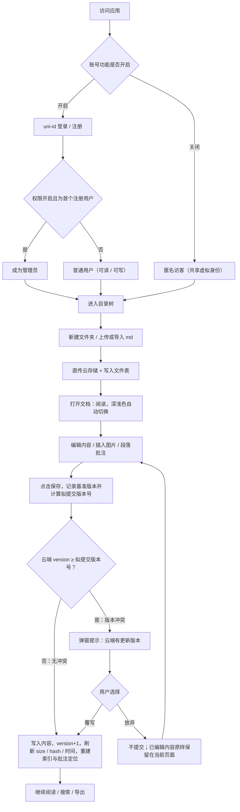

# MarkdownManager 产品需求文档（PRD · 简单版）

> 需求唯一权威来源：`C:\Users\markJing\Desktop\MarkdownManager设计要求.md`。本文按简单 PRD 输出，不含竞品分析与象限图。

## 0. 项目信息

| 项 | 内容 |
| --- | --- |
| Language | 中文（UI 文案、文档、代码注释全中文） |
| Project Name | `markdown_manager` |
| 技术栈 | uni-app（Vue 3）+ uniCloud 支付宝云 + Wot UI（`wot-design-uni`，待安装）+ uni-id（`uni-id-pages` / `uni-id-co` / `uni-id-common`）；H5 响应式 |
| 交付端 | **仅 H5 网页（PC + 移动端浏览器）**，本次不交付小程序 / App |
| 项目现状 | DCloud「hello uniCloud」示例模板：Vue 3（`manifest.json` `vueVersion:"3"`）、`uniCloud-alipay/` 目录；`uni_modules` 已内置 `uni-id-pages`、`uni-id-common`、`uni-id`、`uni-file-picker`、`uni-popup`、`uni-icons` 等；**尚未安装 `wot-design-uni`**；`pages.json` 与 `cloudfunctions/` 全是示例页 / 示例云函数，需重做 |
| 项目规则（AGENTS.md） | 中文优先、先读后改、增量安全（除目标文件外保持其他文件原样）、严禁自主永久删除文件、UI 避免多余小字说明 |

### 0.1 原始需求复述

做一个基于 uni-app + uniCloud（支付宝云）+ Wot UI + uni-id 的、支持 PC 与移动端网页的**多用户 Markdown 文档管理库**：用户上传 / 导入 md 文档，经 `uniCloud.uploadFile` 直传云存储并在数据表登记元数据；以可嵌套的文件夹（支持预制与自定义图标）组织文档；可在网页上阅读（深浅色自动切换）、编辑、插入图片、对段落做精确定位批注；通过标签 / 文件名 / 批注 / 正文分块索引进行搜索；账号功能与权限功能均可在前端开关控制；支持 md 导入导出。界面简约有质感，优先复用成熟组件避免从零开发，首屏有加载动画，开工前先安装依赖。

原文 9 条功能：①md 上传直传云存储与文件表（含字段定义）②文件名修改与层级 / 嵌套文件夹 ③文件夹图标（预制 + 自定义上传）④md 阅读深浅色自动切换、网页编辑与图片插入 ⑤段落批注（独立数据表 + 四级定位优先级 + orphaned）⑥账号功能开关 ⑦权限功能开关 ⑧搜索（标签 / 文件名 / 批注 / 正文 + 索引分块表）⑨导入导出 md。
原文 4 条其他要求：①简约美观有质感、兼顾管理器与阅读器 / 编辑器 ②优先使用 Wot UI / 第三方组件 ③首屏简约有质感加载动画 ④项目已创建、先安装依赖。

### 0.2 交付边界（明确约束）

本地环境**无支付宝云 / 阿里云服务空间凭证、无 HBuilderX 部署通道**，本次交付聚焦：

1. 可编译运行的 H5 源码（重做 `pages.json`、页面、组件、静态资源）；
2. 全部数据库 Schema（文件表、批注表、图片表、索引分块表、系统配置表等 `.json`）；
3. 云对象 / 云函数源码（文件上传删除、版本校验、索引重建、权限校验、服务器时间）；
4. 依赖清单与安装说明（含 `wot-design-uni` 安装与 Wot UI 接入）；
5. 中文部署与联调文档。

**不在本次本地交付范围内**：服务空间创建 / 绑定、Schema 与云函数上传部署、真实 uni-id 登录、真实云存储读写联调、真机与多端兼容验证。以上由用户在 HBuilderX 中完成；相关验收项在第 7 节标注为「部署后验证」，本地 QA 只做源码级与静态逻辑验证。

## 1. 产品目标与定位

**一句话定位**：面向多用户、云端原生的 Markdown 文档库——在 H5 网页上完成 md 文档的组织、阅读、编辑、批注、检索与迁移。

**3 条核心价值链**

1. **内容入库链**：上传 / 导入 → `uniCloud.uploadFile` 直传云存储 → 文件表登记元数据 → 目录树（嵌套文件夹 / 图标 / 标签）归类。
2. **内容生产链**：阅读（深浅色自动切换）→ 在线编辑（图片插入）→ 段落批注（精确锚定）→ 保存（版本校验 + size / hash / 时间戳刷新 + 索引重建）。
3. **内容消费与治理链**：分块索引 → 标签 / 文件名 / 批注 / 正文多维度搜索 → 账号与权限开关治理 → 导出 / 回收站 / 彻底删除。

**产品目标（3 个正交）**

| # | 目标 | 衡量维度 |
| --- | --- | --- |
| G1 | 结构化资产沉淀：多用户、可嵌套目录、云存储直传，让 md 文档有序可管 | 目录层级正确率、上传落库成功率、元数据完整率 |
| G2 | 沉浸式读写与精确标注：深浅色阅读、在线编辑、图片插入、段落批注不丢失锚点 | 批注命中率、orphaned 误判率、编辑保存成功率 |
| G3 | 可检索可迁移可治理：全文分块索引搜索、导入导出、开关式账号权限 | 搜索召回率、导入导出一致性、权限拦截准确率 |

## 2. 角色与用户故事

> 账号功能与权限功能均为**可开关**配置，角色随配置生效或失效。

| 角色 | 生效条件 | 核心权责 |
| --- | --- | --- |
| 管理员 | 权限功能开启时，**首个注册账号**自动成为管理员 | 全部文件读写、用户权限管理（可读 / 可写）、系统设置（账号 / 权限开关）、回收站与彻底删除 |
| 普通用户 | 账号开启 + 已登录 | 自己名下文档的上传 / 导入 / 改名 / 移动 / 编辑 / 批注 / 搜索 / 导出 / 删除；按权限位被授予他人文档的可读 / 可写 |
| 匿名访客 | 账号功能关闭 | 无需登录密码，直接进入并读写共享文档库 |

**用户故事**

| # | 用户故事 |
| --- | --- |
| US1 | 作为**普通用户**，我希望上传 / 导入 md 后自动生成随机云端文件名并按嵌套目录归类，以便文档不重名、不散乱且可整理。 |
| US2 | 作为**普通用户**，我希望在网页上直接编辑 md、插入图片并保存，以便不依赖本地工具更新内容，且并发修改时我的编辑内容不会被清空。 |
| US3 | 作为**普通用户**，我希望对某段文字加批注、并在文档被改动后仍能找到原段落，以便注释不因排版变化而错位或误绑。 |
| US4 | 作为**普通用户**，我希望按标签、文件名、批注或正文关键词搜到文档并可导入导出，以便快速回看与迁移知识片段。 |
| US5 | 作为**管理员**，我希望在设置中开关账号与权限并分配可读 / 可写，以便在小团队免登录共用与正式多用户之间平滑切换（关闭账号后匿名访客可直接读写）。 |

## 3. 需求池

优先级定义：**P0 必须**（本次交付）、**P1 应该**（体验与健壮性增强）、**P2 可选**（后续迭代）。P0 逐条覆盖原文 9 条功能 + 4 条其他要求。

### 3.1 P0 必须交付

| 编号 | 来源 | 需求描述 | 验收要点 |
| --- | --- | --- | --- |
| R01 | 功能 1 | md 上传经 `uniCloud.uploadFile({ filePath, cloudPath })` 直传 uniCloud 内置云存储（支付宝云）；`cloudPath` 用随机字符串并保留 `.md`，建议 `markdown/{user_id}/{uuid}.md`；文档信息写入数据表 | 云存储文件存在且命名合规，文件表有对应记录 |
| R02 | 功能 1 | 文件表字段：`_id / user_id / parent_id / name / extension / storage_key / size / content_hash / tags / created_at / version / updated_at / is_delete`；`extension` 默认 `md` 且预留后续格式 | 字段齐全、类型正确 |
| R03 | 功能 1 | 同目录同名文档自动追加 `-copy1`、`-copy2`… 后缀；改名撞名同样适用 | 重名不覆盖、序号递增 |
| R04 | 功能 1 / 规则 C1 | `version` 初始 0，每次成功修改 +1；保存时云端 `version >= 拟提交版本号` 判定冲突，弹窗提供「覆写 / 放弃」；**放弃时用户编辑内容必须保留在当前前端页面** | 并发场景可复现，放弃不清空编辑器 |
| R05 | 功能 1 / 规则 C2 | 删除二态：普通删除置 `is_delete=true` 进回收站可还原；彻底删除同时删除云存储源文件与数据表记录（含关联子记录） | 回收站可还原、彻底删除无残留 |
| R06 | 功能 2 | 文件名可修改；层级显示；自定义文件夹；文件夹可套文件夹；文件可放入 / 移动到任意文件夹下 | 三级嵌套、`parent_id` 正确 |
| R07 | 功能 3 | 文件夹图标：提供预制图标，支持用户上传自定义图标 | 预制可选、自定义可显示 |
| R08 | 功能 4 | Markdown 阅读器，跟随系统偏好自动切换深色 / 浅色模式 | 深浅色自动跟随、md 渲染正确 |
| R09 | 功能 4 | 网页端 md 编辑器；可插入图片，图片存入云空间并写入云数据表；插入时可选「直接上传新图片」或「从存储空间已有图片插入」 | 两种插入路径均落库，不重复上传 |
| R10 | 功能 5 | 段落批注另存数据表，字段 `_id / file_id / user_id / selected_text / prefix / suffix / start_offset / end_offset / comment / status / created_at / updated_at` | 字段齐全、锚点信息完整 |
| R11 | 功能 5 / 规则 C4 | 批注定位四级优先级；`active`（成功匹配）/ `orphaned`（原文被删或无法定位）状态自动更新 | 四级场景均可验证 |
| R12 | 功能 6 | 账号功能可开关、**默认开启**、在前端网页中设置；关闭后每个访问者视作一个用户、无需登录密码可直接修改文件；系统存在多个用户时须删除至单用户后才允许关闭 | 开关生效、多用户时拒绝关闭 |
| R13 | 功能 7 | 权限功能可开关；开启时首个注册用户为管理员，可管理后续账号权限，粒度仅「可读 / 可写」；不开启时每个用户默认全部可读可写 | 管理员可授权、只读用户写入被拒 |
| R14 | 功能 8 | 搜索标签、文件名、批注、正文；新增索引分块表存提纯后的 md 内容，字段 `chunk_id / file_id / user_id / heading / content / keywords / start_offset / end_offset / revision`；保存后重建索引 | 四个维度均可命中、索引随版本刷新 |
| R15 | 功能 9 | 导入 / 导出 md 文档 | 导入落库、导出内容一致 |
| R16 | 技术栈 / 参考文档 | uni-id 采用 `uni-id-pages` + `uni-id-co` + `uni-id-common`（不使用已停止更新的旧版 uni-id 公共模块）；云存储客户端 API 用 `uploadFile` / `getTempFileURL` / `deleteFile` | 依赖与调用一致 |
| R17 | 其他 1 / AGENTS.md | 简约美观有质感 UI，兼顾文档管理器 + 阅读器 + 编辑器；PC 三栏、移动端单栏抽屉；信息层级清晰，**避免不必要的次要标签与小字说明** | 三栏 / 抽屉、无冗余说明文案 |
| R18 | 其他 2 | 优先复用 Wot UI（`wot-design-uni`）或第三方成熟组件，避免所有功能从零开发 | 组件被实际引用 |
| R19 | 其他 3 | 首屏加载中动画，简约有质感，首屏未加载完成前播放 | 加载期间播放、就绪后淡出 |
| R20 | 其他 4 | 项目已创建、在选定目录下工作、**先安装需要的依赖**（含 `wot-design-uni`）；重做示例 `pages.json` 与示例云函数为真实业务页面与云对象 | 无示例残留、依赖已安装 |
| R21 | 交付边界 | DB Schema、云对象 / 云函数、可运行 H5 源码、依赖清单、中文部署联调文档齐备 | 见第 7 节 AC-31 |

### 3.2 P1 应该交付（健壮性与体验增强）

| 编号 | 需求描述 |
| --- | --- |
| R22 | 已有图片空间管理（列表 / 复用 / 清理）与图片引用计数，避免共享图片被误删 |
| R23 | 回收站批量还原 / 批量彻底删除；还原撞名按 `-copyN` 处理 |
| R24 | 搜索结果命中高亮与按 `start_offset` 跳转定位；批注侧栏列表与锚点跳转 |
| R25 | 标签编辑与批量打标签；深色模式手动覆盖开关 |
| R26 | 上传 / 保存 / 删除的结果反馈与失败重试；索引重建失败可补偿重跑 |
| R27 | 文件夹树拖拽移动 / 排序 |

### 3.3 P2 可选（后续迭代）

| 编号 | 需求描述 |
| --- | --- |
| R28 | `extension` 扩展支持 md 以外格式（原文「后期会增加其他格式」） |
| R29 | 批注回复 / 多人协作、版本历史与回滚 |
| R30 | 文档只读分享链接、操作日志 |
| R31 | 搜索分词、关键词高亮进阶、搜索历史 |

## 4. 关键业务规则

### 4.1 C1 版本乐观锁冲突

- 文档 `version` 初始为 0，每次**成功保存**后 +1。
- 客户端打开文档时记录基准版本 `base_version`；点击保存时**拟提交版本号 = `base_version + 1`**。
- 服务端判定：若 `云端 version >= 拟提交版本号`，说明云端已被他人更新 → 返回冲突（携带云端最新 version 与内容摘要）。正常无并发时 `云端 version = base_version < 拟提交版本号`，不冲突。
- 冲突弹窗两个动作：
  - **覆写**：以本地内容强制写入，`version = 云端 version + 1`，刷新元数据与索引；
  - **放弃**：不提交任何写操作，服务端数据保持不变。
- **强制约束**：无论覆写或放弃，用户已编辑内容必须**原样保留在当前前端编辑器页面上**，不得清空、不得刷新页面、不得跳回阅读态；放弃后用户可继续编辑或重新保存。
- **口径说明**：原文「云端大于或等于用户版本号」中的「用户版本号」，本文定义为**本次拟提交的新版本号（base+1）**，从而与「version 初始 0、首次保存不应冲突」自洽；若本意是拿 `base_version` 直接比对，条件应改为 `云端 version > base_version`，见第 8 节 Q1。

### 4.2 C2 删除 / 彻底删除 / 回收站

- **普通删除**：仅置 `is_delete=true`，保留云存储源文件与数据表记录；回收站按 `is_delete=true` 过滤展示，可还原（置回 `false`）。
- **彻底删除**：不可恢复，必须由云对象 / 云函数执行：读取 `storage_key`（fileID）→ `uniCloud.deleteFile({ fileList: [fileID] })` 删除源文件 → 删除文件表记录 → 按 `file_id` 级联删除批注、索引分块等子记录；任一步失败整体报错，不允许留下孤儿记录或孤儿文件。
- 文件夹彻底删除需递归收集所有后代文档的 `storage_key` 一并删除。
- 回收站中的普通删除**不动云存储文件**。

### 4.3 C3 元数据与服务器时间

- `size`、`content_hash`：**每次编辑保存成功后按最新内容重算并更新**（hash 建议对内容文本做 SHA-256）；上传时写入初始值。
- `created_at`：创建时写入一次，**任何后续更新均不可修改**。
- `updated_at`：每次成功保存后更新。
- 批注表 `created_at` 不可修改；`updated_at` 每次修改批注时自动更新。
- 所有时间字段一律以**服务器时间**（云函数 / 云对象侧 `new Date()` 或 `db.serverDate()`）为准，**不信任客户端传入的时间值**。

### 4.4 C4 批注定位四级优先级

文档保存后，对该 `file_id` 下所有 `active` 批注依次重定位：

1. 先按 `start_offset` + `selected_text` 检查原位置，命中即绑定；
2. 失败则全文搜索 `selected_text`，唯一命中即绑定；
3. 若存在多个匹配结果，用 `prefix + selected_text + suffix` 做上下文匹配消歧；
4. 仍无法确定位置 → 置 `status = orphaned`，**不得随便把批注绑定到其他文字**。

`active` = 成功匹配原文正常显示；用户编辑时删除了全部原文，保存修改时自动更新为 `orphaned`；orphaned 批注在 UI 上以独立态展示，不误导定位。

### 4.5 C5 账号与权限开关

- 账号功能默认**开启**；权限功能仅在账号开启前提下才可开启。
- 关闭账号功能前，后端校验用户数：存在多个用户时拒绝关闭并提示需先删除至单用户。
- 权限开启：首个注册用户为管理员，可为后续用户分配「可读 / 可写」；权限关闭：所有用户默认全部可读可写。
- 所有写操作在服务端按角色 / 权限位二次校验，前端隐藏入口不作为安全边界。

### 4.6 C6 索引分块与搜索

- 索引表存**提纯后的纯文本**（去除 md 标记），按「标题分块 + 超长再切片」组织，记录相对全文的 `start_offset` / `end_offset` 与 `revision`（= 保存后的文件 version）。
- 文档每次成功保存后，按 `file_id` 精确范围**先删后插**重建全部分块；`revision` 与文件 version 对齐，便于识别陈旧索引。
- 搜索维度：标签、文件名、批注内容、正文（走索引表 `content` / `keywords`）；正文命中后可依 `start_offset` 回跳文档段落。

### 4.7 C7 图片存储与展示

- 插入图片两种来源：① 新上传 → `uniCloud.uploadFile` 直传云存储 + 图片表新增记录；② 从已有空间选择 → 复用已有 `fileID`，不重复上传。
- 展示时用 `uniCloud.getTempFileURL` 换临时 URL，**临时 URL 不落库**，库中只存 `fileID`。

## 5. UI 设计稿描述

### 5.1 布局

**PC 三栏**（信息层级由「结构 → 清单 → 内容」递进）：

| 栏位 | 内容 |
| --- | --- |
| 左 · 侧边目录树 | 嵌套文件夹树、文件夹图标（预制 / 自定义）、新建 / 改名 / 移动 / 删除入口、回收站与设置入口；当前选中态明确 |
| 中 · 文件列表 | 当前目录下的文档清单（名称、标签、更新时间、大小）、上传 / 导入按钮、搜索框、排序与视图切换 |
| 右 · 阅读·编辑区 | md 渲染 / 编辑器切换、深浅色自动、图片插入工具栏、批注侧栏（锚点高亮 + 批注列表）、版本冲突弹层、保存状态 |

**移动端单栏 + 抽屉**：默认只显示当前栏（阅读 / 编辑区优先）；目录树与文件列表收入左侧抽屉，由顶部导航按钮唤起；工具栏收进底部操作条；搜索为全屏浮层。

### 5.2 视觉与质感

- 简约、留白充足、圆角与细分隔线；以排版层级、间距与选中态传达结构，**不堆砌次要标签与小字说明**；仅保留必要的错误提示与操作反馈（遵循 AGENTS.md UI 要求）。
- 深浅色两套配色自动跟随系统 `prefers-color-scheme`：浅色偏暖白底 + 深墨色正文；深色偏中性深灰底 + 柔白正文；强调色单一克制，用于选中态、链接与批注锚点。
- 代码块 / 表格 / 引用等 md 元素有独立样式层级，阅读区行宽与字号适配长文。
- 质感来源：轻微层次阴影、克制的过渡动效、统一图标（uni-icons + Wot UI）、加载与保存的微反馈，而非装饰性贴图。

### 5.3 首屏加载动画

- 首屏数据（系统配置、登录态、目录树）未就绪前播放：简约的品牌字形 / 文档轮廓线稿，配合轻缓的呼吸或描边动画；单色、无多余文案。
- 数据就绪后淡出并无缝切入主界面；动画不阻塞、不闪烁、不出现空白跳变。

### 5.4 组件策略

优先使用 Wot UI（`wot-design-uni`）与已内置 `uni_modules`（`uni-file-picker`、`uni-popup`、`uni-icons`）、`uni-id-pages`；md 编辑 / 渲染、目录树等采用成熟第三方 Vue 3 组件，不自研全套基础交互。

## 6. 用户主流程（登录 → 目录 → 打开文档 → 编辑保存 → 版本校验）

## 7. 验收标准（供 QA 编写用例）

> 标注「部署后验证」的条目需在用户于 HBuilderX 完成服务空间绑定与云函数部署后执行；本地只做源码级与静态逻辑验证。

**A. 上传与元数据**

| 编号 | 验收条目 |
| --- | --- |
| AC-01 | 选择 .md 上传后，云存储出现 `markdown/{user_id}/{uuid}.md`（随机名 + `.md` 后缀）；文件表新增记录且 12 个字段齐全、`version=0`、`extension='md'`、`created_at` 有值。〔部署后验证〕 |
| AC-02 | 同目录连续上传同名文件，名称依次为原名、`原名-copy1.md`、`原名-copy2.md`；改名撞名同样追加 `-copyN`。 |
| AC-03 | 每次编辑保存成功后 `size`、`content_hash`、`updated_at` 变化且 `version+1`；`created_at` 始终不变。 |
| AC-04 | 客户端伪造 `created_at` / `updated_at` 提交，落库值仍为服务器时间。〔部署后验证〕 |

**B. 目录与图标**

| 编号 | 验收条目 |
| --- | --- |
| AC-05 | 可创建三级嵌套文件夹，文件可放入 / 移动，目录树层级与 `parent_id` 一致。 |
| AC-06 | 文件夹可选预制图标、可上传自定义图标并正确显示。 |

**C. 阅读 / 编辑 / 图片**

| 编号 | 验收条目 |
| --- | --- |
| AC-07 | 系统切换深色 / 浅色，阅读器自动跟随；md 标题、列表、代码块、表格、图片渲染正确。 |
| AC-08 | 「上传新图片」插入后云存储新增图片且图片表新增记录；「从已有空间选择」不产生新上传、引用同一 `fileID`。〔部署后验证〕 |
| AC-09 | 库中只存 `fileID`，展示 URL 由 `getTempFileURL` 临时生成且未持久化。 |

**D. 版本冲突**

| 编号 | 验收条目 |
| --- | --- |
| AC-10 | 两个会话打开同一文档（基准版本相同），A 先保存成功，B 保存时收到「云端有更新版本」提示。 |
| AC-11 | B 选「覆写」：内容写入、`version = 云端 version + 1`、元数据与索引刷新。 |
| AC-12 | B 选「放弃」：服务端内容 / version 不变，**B 编辑器内已编辑文字仍在页面上**，可继续编辑或再次保存。 |

**E. 批注**

| 编号 | 验收条目 |
| --- | --- |
| AC-13 | 选中段落新建批注，记录含 `selected_text / prefix / suffix / start_offset / end_offset / comment / status=active`。 |
| AC-14 | 四级定位分别验证：原位置命中 / 唯一文本命中 / 上下文消歧多匹配 / 无法确定时置 `orphaned` 且不误绑其他文字。 |
| AC-15 | 删除批注所依附的全部原文并保存，该批注 `status` 自动变为 `orphaned`。 |
| AC-16 | 修改批注后 `updated_at` 更新、`created_at` 不变。 |

**F. 账号 / 权限**

| 编号 | 验收条目 |
| --- | --- |
| AC-17 | 默认账号功能开启，未登录访问进入登录 / 注册页（uni-id-pages）。 |
| AC-18 | 关闭账号功能后无需登录即可直接读写文件；系统存在 >1 个用户时关闭操作被拒绝并给出明确提示。 |
| AC-19 | 权限开启时首个注册用户为管理员；管理员将某用户设为只读后，该用户保存请求被服务端拒绝且无写入。 |
| AC-20 | 权限关闭时新用户默认可读可写；所有写接口服务端二次校验权限，绕过前端入口亦被拦截。〔部署后验证〕 |

**G. 搜索 / 索引**

| 编号 | 验收条目 |
| --- | --- |
| AC-21 | 按标签、文件名、批注内容、正文关键词分别可命中目标文档。 |
| AC-22 | 保存编辑后索引重建：旧关键词不再命中、新关键词可命中，分块 `revision` 与文件 `version` 一致。 |
| AC-23 | 正文命中结果可按 `start_offset` 回跳到对应段落。 |

**H. 导入导出 / 删除**

| 编号 | 验收条目 |
| --- | --- |
| AC-24 | 导入 md 后生成文件表记录 + 云存储文件；导出的 md 内容与云端内容字节一致。 |
| AC-25 | 普通删除后 `is_delete=true`，回收站可见并可还原；还原撞名按 `-copyN` 处理。 |
| AC-26 | 彻底删除后：云存储源文件不存在、文件表记录不存在、关联批注与索引分块记录被清理；文件夹彻底删除递归清理所有后代文件。〔部署后验证〕 |

**I. UI / 工程 / 交付**

| 编号 | 验收条目 |
| --- | --- |
| AC-27 | PC 显示三栏、移动端单栏 + 抽屉；深浅色两套配色完整；界面无多余小字说明，仅保留必要错误与操作反馈。 |
| AC-28 | 首屏数据未就绪前播放加载动画，就绪后淡出，无闪烁或空白跳变。 |
| AC-29 | `wot-design-uni` 已安装且有组件被实际引用；`pages.json` 与 `cloudfunctions/` 无残留示例页 / 示例云函数。 |
| AC-30 | 全量中文 UI 文案与代码注释；除目标文件外无无关文件改动；无文件被永久删除。 |
| AC-31 | 本地源码可编译为 H5；DB Schema、云对象 / 云函数、依赖清单、中文部署联调文档齐备；云端部署与真实联调由用户在 HBuilderX 完成。 |

## 8. 待确认问题与默认假设

> 未获确认前，一律按「默认假设」实现；架构师可据此开展设计。

| 编号 | 待确认问题 | 默认假设 |
| --- | --- | --- |
| Q1 | 版本冲突中「用户版本号」的口径：原文写「云端 version >= 用户版本号」，但若理解为打开时的 `base_version`，则首次保存（云端 0 >= 本地 0）就会误报冲突。 | 「用户版本号」= **本次拟提交的新版本号 = `base_version + 1`**，冲突条件按原文 `云端 version >= 拟提交版本号`，与「version 初始 0、首次保存不冲突」自洽。备选（若本意是拿 `base_version` 直接比）：条件改为 `云端 version > base_version`。**无论哪种口径，冲突弹窗与「放弃后编辑内容保留在页面」必须实现。** |
| Q2 | **账号 / 权限开关的配置存储位置与谁能修改**：配置放哪张表？匿名模式（无登录态）下谁有权改回开启？ | 新增系统配置表 `mm-settings` 单条文档（`key=app_config`），字段 `account_enabled`（默认 `true`）、`permission_enabled`（默认 `false`）；应用启动时由云对象读取并下发前端，决定渲染登录页还是匿名直入。修改入口为前端「设置」页，**仅管理员可见可改**；关闭账号功能时后端校验用户数，>1 拒绝。匿名模式下保留同一「设置」入口且不做登录校验（因此时无登录态），由后端保证幂等；**该开放入口的安全风险请用户确认**是否需加一个独立于 uni-id 的管理口令。 |
| Q3 | **匿名模式下 `user_id` 的生成方式**：是每个浏览器各生成一个设备 ID，还是所有访客共享一个身份？ | 账号关闭后所有访客共享**固定虚拟用户 ID `__anonymous__`** 写入 `user_id`，前端不落地设备标识，所有文档归属该 ID、人人可读可写。理由：原文要求「关闭账号功能前须把用户收敛到单用户」，共享单一身份不会在匿名态下重新产生多用户，且与「每个访问应用的都视作一个用户」在共享库语义下自洽。备选（若希望区分访客）：按浏览器本地存储生成 `anonymous_{uuid}` 设备 ID，但会与「单用户」约束冲突，需同步调整关闭校验规则。 |
| Q4 | **H5 端 md 编辑器选型的约束**：用哪个编辑器、需满足什么条件才能支撑图片插入与批注 offset 定位？ | 选用 Vue 3 原生、可在 H5 运行的成熟 md 编辑器（首选 `md-editor-v3`；若其选区 API 不足以支撑 offset 级批注定位，则降级 Vditor）。**四项硬约束**：① Vue 3 兼容、纯浏览器渲染（本次仅交付 H5）；② 暴露自定义图片上传钩子，可对接 `uniCloud.uploadFile` + 图片表写入；③ 可读写纯文本并提供选区 / 光标 offset，用于批注定位与索引分块；④ 支持受控内容，保证版本冲突「放弃」后编辑内容不丢失。具体选型由架构师在约束内确定并写入设计说明。 |
| Q5 | **索引分块粒度**：按什么切块、offset 基准是什么、`revision` 取什么值？ | 按 Markdown 标题（`#`~`######`）划分逻辑块，`heading` 取标题文本；块内提纯文本超过 **1000 字符**再按固定长度切片，相邻块 **100 字符重叠**避免断句；`start_offset` / `end_offset` 为相对全文提纯文本的字符偏移（与原文示例 0~1000 对齐）；`keywords` 取标题词 + 高频实词；`revision` = 保存后的文件 `version`。每次成功保存按 `file_id` 先删后插重建全部分块。 |
| Q6 | **彻底删除时云存储文件的删除方式**：客户端删还是服务端删？删除顺序？图片是否级联删除？ | 彻底删除 = **服务端双删**，由云对象 / 云函数执行：读取 `storage_key`（fileID）→ `uniCloud.deleteFile({ fileList: [fileID] })` → 删文件表记录 → 按 `file_id` 级联删批注、索引分块；**先确认云存储删除成功再删记录**，失败即整体报错，避免孤儿文件 / 孤儿记录。文件夹递归收集后代 `storage_key` 批量删除。**图片资源不随文档彻底删除级联删除**（图片由图片空间统一管理、可能被多文档复用），需用户在图片空间单独清理；如要求级联，须引入图片引用计数（见 P1 的 R22）。 |
| Q7 | 本期是否只支持 `.md`？ | 本期只支持 `.md`；表结构保留 `extension` 字段且不做硬编码限制，为后续格式预留（原文「后期会增加其他格式」）。 |
